# SmartAudit efr · avances de la plataforma

**Estado:** Fase 1 completada (base, configuración y muestra), con los cambios 1 y 2 pedidos por la Fundación
(perfiles por entidad de auditoría, auditorías, máximo de entrevistas y listados con búsqueda) y la página de acceso con
código adelantada de la Fase 2.
**Fecha de las capturas:** 19 de noviembre de 2026.
**Servidor de pruebas:** https://efr-staging.bumii.ai
**Qué ha cambiado desde la versión anterior:** [informe de cambios](informe-cambios-1-y-2.md).
**Fase 2 (invitaciones y entrevista con IA):** [presentación de la Fase 2](fase-2.md), con 17 capturas más.
**Cambios #3 (grupo de cambios 3 y entrevista conversada):** [informe de cambios #3](informe-cambios-3.md), con 20 capturas
hechas en el servidor de pruebas con la IA real.

Las imágenes están en [`img/`](img/) y muestran la plataforma real con **datos sintéticos**: las organizaciones, las
personas y los correos son ficticios. Las **entidades de auditoría** sí son las reales (AENOR, APCER, AUDELCO, CMD, DNV,
EDUQATIA, ICONTEC, LOT y SGS), porque forman parte de la configuración. Las capturas siguen el recorrido completo:
acceso, superadministración, coordinación, trabajo del auditor y acceso de una persona participante.

---

## Resumen para la presentación

| Qué ya funciona | Qué viene después |
|---|---|
| Acceso sin contraseñas por enlace de un solo uso, en español, inglés, portugués y francés | Revisión de respuestas dudosas por el auditor (Fase 3) |
| Entidades de auditoría con sus coordinadores, que designan el auditor de cada organización | Cálculo de resultados y síntesis (Fase 3) |
| Listados con búsqueda, filtros, orden y páginas, pensados para cientos de organizaciones | Informe de auditoría en Word, Excel y PDF (Fase 3) |
| Configuración versionada: tabla de mínimos y cuestionario M1 | Piloto real y puesta en producción (Fase 4) |
| Auditorías con cálculo automático del mínimo, el máximo, la ventana y las preguntas | |
| Carga de la muestra con validación fila a fila y códigos para personas sin correo | |
| **Fase 2:** invitaciones y recordatorios por correo, entrevista escrita con IA acotada en el móvil, seguimiento del avance y cierre automático ([ver la Fase 2](fase-2.md)) | |

### Quién hace qué

| Perfil | Quién es | Qué hace en la plataforma |
|---|---|---|
| **Superadministración** | Fundación Másfamilia y Bumii | Da de alta las entidades de auditoría y sus coordinadores, crea las organizaciones y las asigna a una entidad y un coordinador, y mantiene la configuración |
| **Coordinación** | Coordinador/a de auditorías de una entidad (por ejemplo, ICONTEC) | Ve las organizaciones que le asigna la Fundación, da de alta a sus auditores y designa el auditor de cada organización (puede ser él o ella) |
| **Auditor/a** | Auditor/a de una entidad | Crea la auditoría de cada organización que tiene asignada, carga la muestra y, en las fases siguientes, sigue las entrevistas y genera el informe |
| **Persona participante** | Persona de la muestra | Responde a su entrevista, sin cuenta |

La **empresa auditada no tiene acceso** a la plataforma.

---

## 1. Acceso a la plataforma

### 01 · Pantalla de acceso


Portada con el claim de la marca **«efr es conciliación.»**. No hay contraseñas: la persona escribe su correo y recibe
un **enlace de acceso de un solo uso, válido 15 minutos**. Arriba se elige el idioma de la interfaz: **español,
inglés, portugués de Portugal o francés**.

### 02 · Enlace de acceso en pantalla (entorno de pruebas)


Como el entorno de pruebas aún no está conectado al correo, el enlace aparece directamente en pantalla con el botón
**«entrar con el enlace»**. En producción llegará por correo electrónico y esta opción no existirá.

### 03 · Elección de la entidad de auditoría

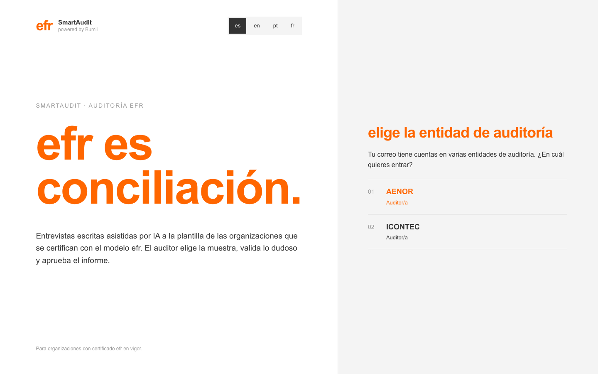

Un mismo auditor puede trabajar para **varias entidades de auditoría** (en el ejemplo, ICONTEC y AENOR). Al entrar
elige con cuál trabaja, y la plataforma **mantiene separada la información de cada entidad**: desde ICONTEC no se ve
nada de lo que hace en AENOR.

---

## 2. Superadministración (Fundación Másfamilia y Bumii)

### 04 · Entidades de auditoría

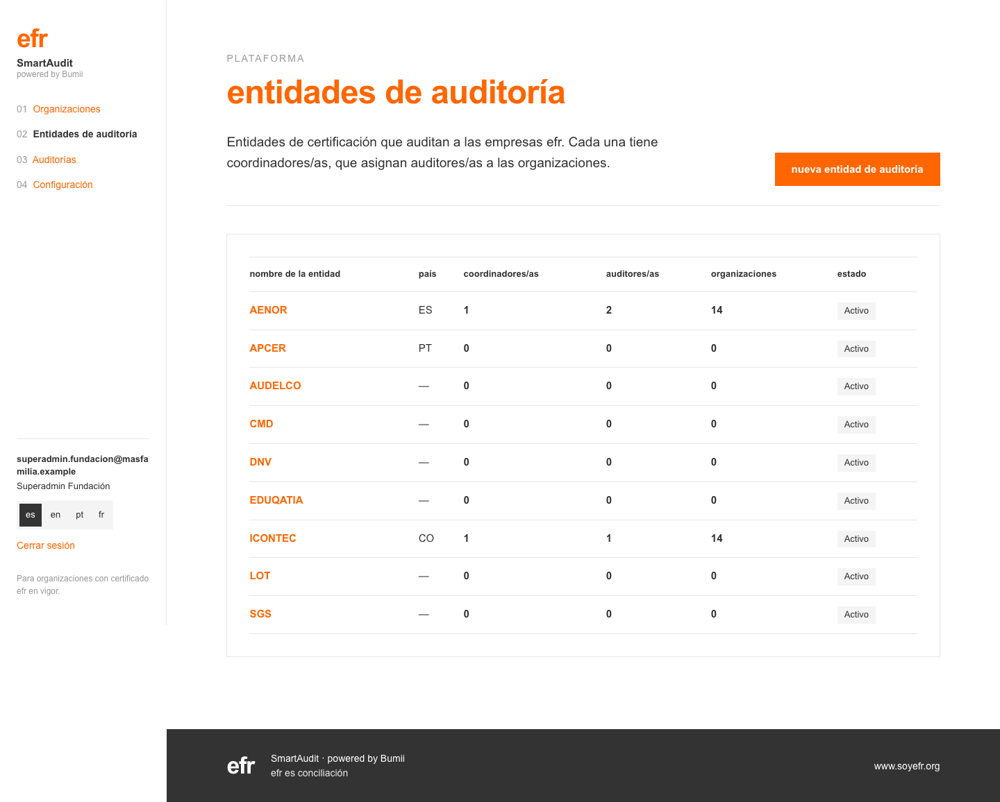

La **tabla maestra de entidades de auditoría**, con las nueve entidades actuales y, para cada una, cuántos
coordinadores, auditores y organizaciones tiene. La Fundación puede **añadir** nuevas entidades, **editar** su nombre y
país, y **desactivarlas** (se conserva su histórico).

### 05 · Ficha de una entidad

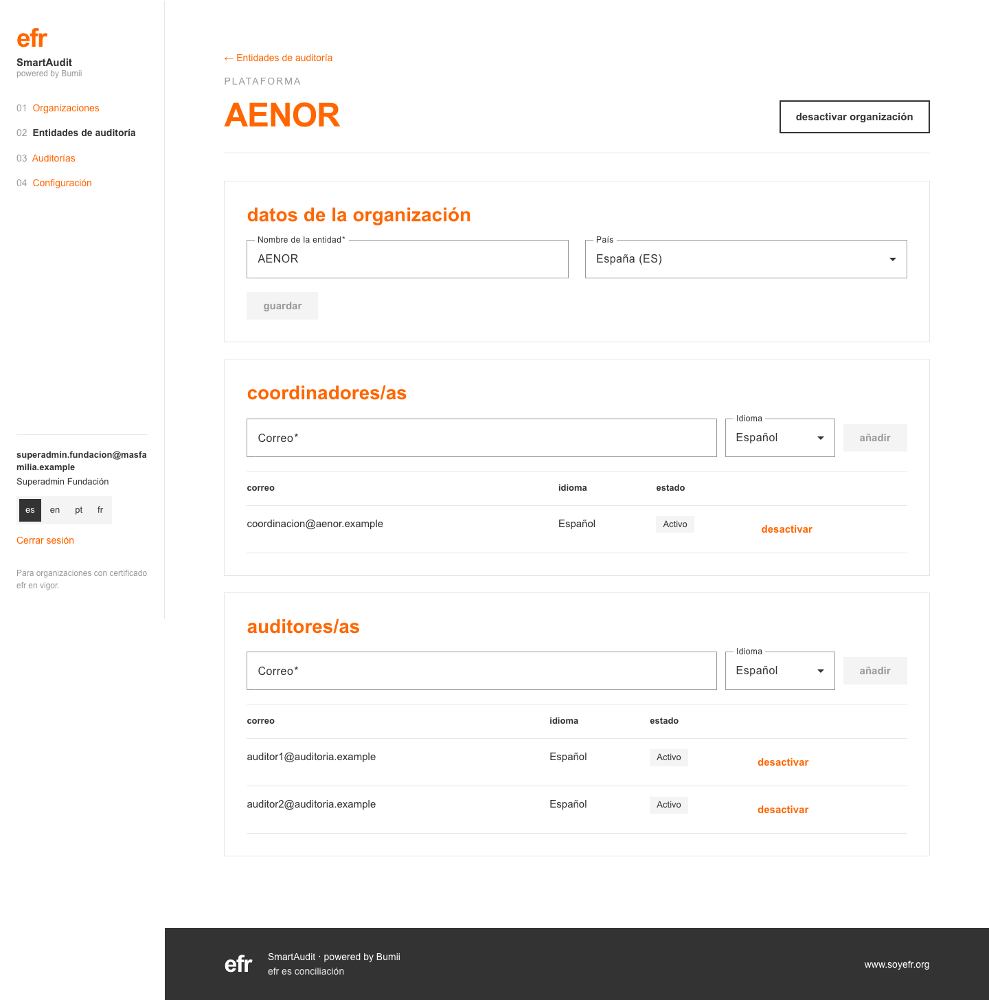

Datos de la entidad y sus **coordinadores** y **auditores**: alta por correo, idioma preferido y activar o desactivar.
La persona dada de alta recibe un aviso por correo.

### 06 · Organizaciones

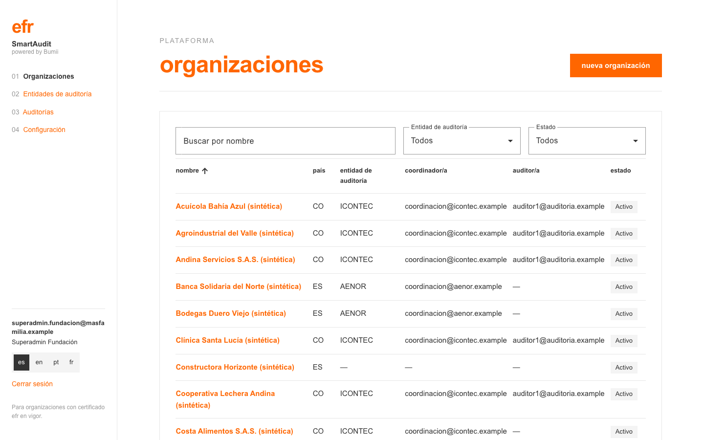

Listado de las empresas efr con su país, su **entidad de auditoría**, su **coordinador/a** y su **auditor/a**. Pensado
para 300–400 organizaciones:

- **Buscador** por nombre, que no distingue mayúsculas ni acentos.
- **Filtros** por entidad de auditoría (incluidas las organizaciones «sin entidad asignada») y por estado.
- **Columnas ordenables** (nombre, país, estado).
- **Páginas** de 25 filas (se puede elegir 10, 25, 50 o 100).

### 07 · Búsqueda de una organización


Al escribir «andina» aparecen al momento las dos organizaciones que lo contienen. La búsqueda se conserva al abrir una
organización y volver atrás.

### 08 · Ficha de una organización

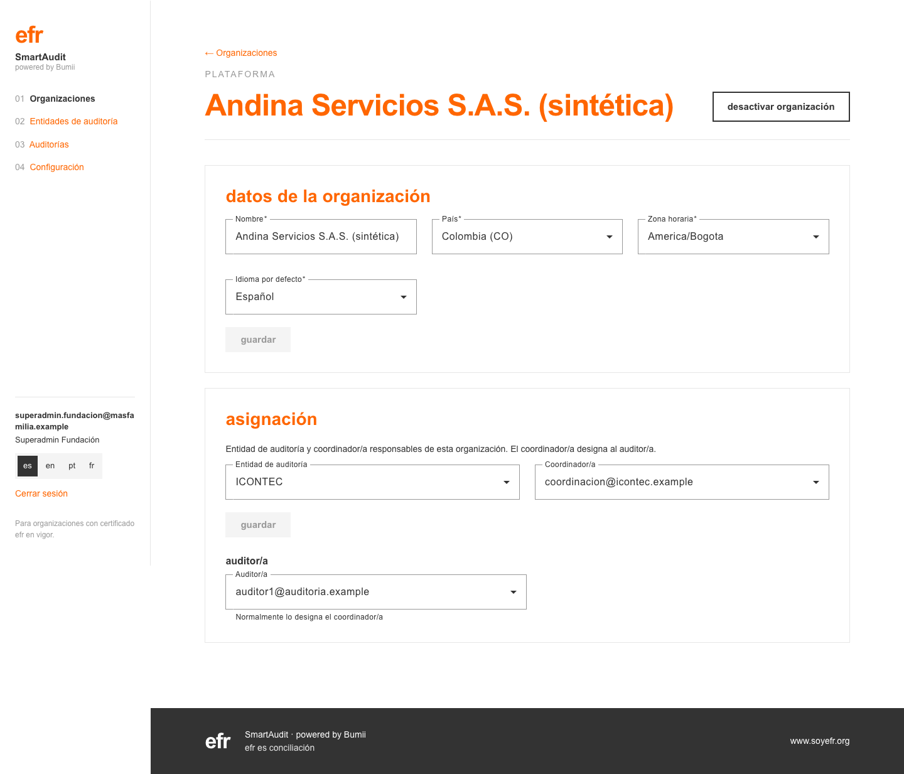

Datos de la organización (país, zona horaria e idioma) y su **asignación**: la entidad de auditoría y el coordinador
que la llevan. El auditor lo designa normalmente el coordinador, pero la Fundación también puede cambiarlo. La zona
horaria marca **a qué hora local** abren y cierran las entrevistas.

### 09 · Tabla de mínimos de entrevistas


La tabla oficial (*Tablas entrevistas.xlsx*) que fija el **mínimo de entrevistas completadas** según la población
total: de 14 (hasta 90 personas) a 91 (hasta 16.000). Por encima de 16.000, el auditor fija la cifra entre 91 y 143.
Está **versionada**: una versión publicada no se modifica y cada auditoría conserva la versión con la que se creó.

### 10 · Cuestionario oficial M1

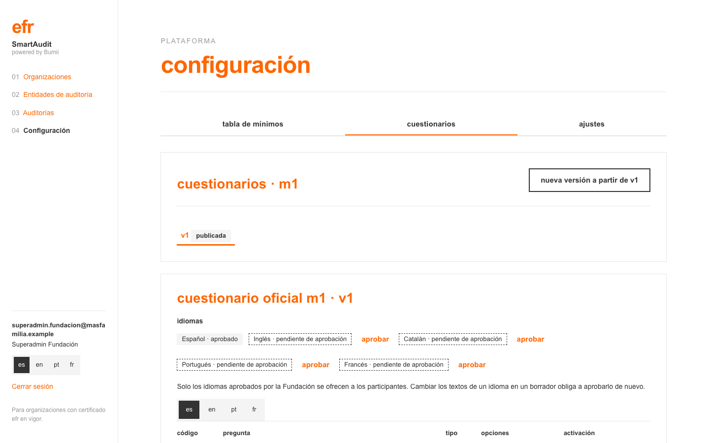

El cuestionario oficial (P1 a P10) con sus textos por idioma. El español está **aprobado**; inglés, portugués y francés
están **pendientes de aprobación por la Fundación** y no se ofrecerán a las personas participantes hasta que se
aprueben. Más abajo se ven las preguntas, sus opciones y sus **reglas de activación**: por ejemplo, P8 solo en
renovaciones y P9 solo si se postula a la excelencia.

---

## 3. Coordinación de la entidad de auditoría

### 11 · Mis organizaciones

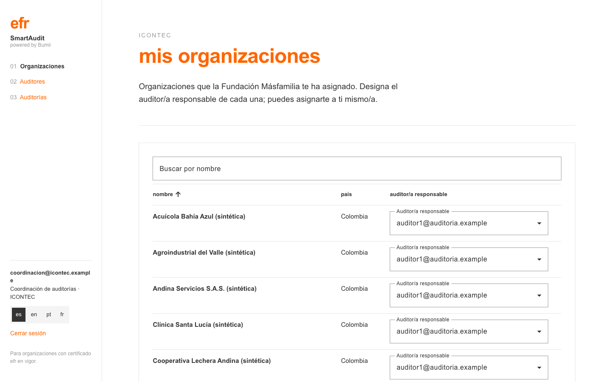

El coordinador de ICONTEC ve **solo las organizaciones que la Fundación le ha asignado**, con buscador, orden y
páginas (un coordinador puede llevar 50–60 empresas). En cada fila elige el **auditor responsable**.

### 12 · Designar el auditor

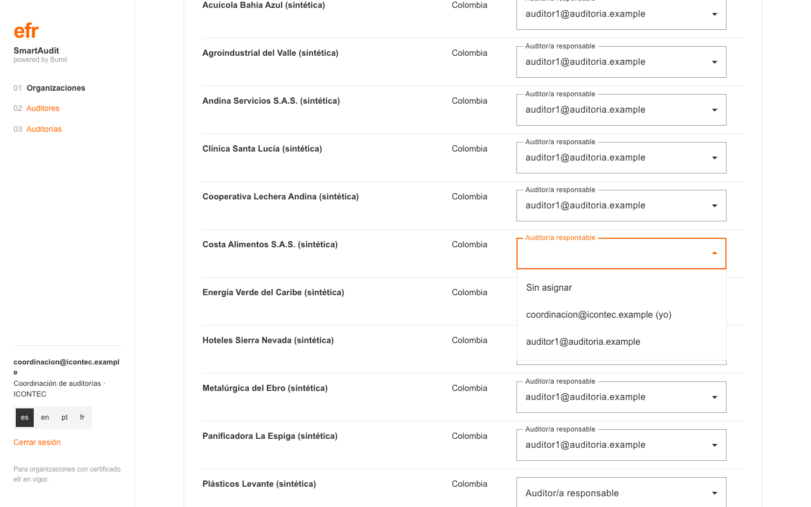

El desplegable ofrece los auditores activos de su entidad y al propio coordinador («yo»), que puede **asignarse a sí
mismo**. Si cambia el auditor de una organización, sus auditorías abiertas **pasan al nuevo auditor** y el cambio queda
registrado.

### 13 · Auditores de la entidad

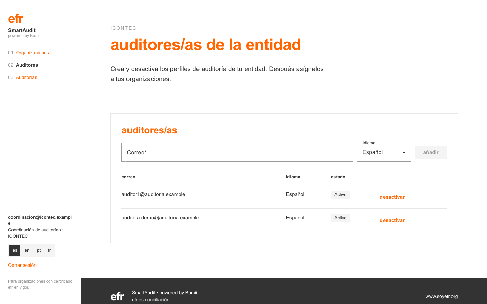

El coordinador da de alta y desactiva a los auditores de su entidad.

### 14 · Auditoría vista por el coordinador: solo avance

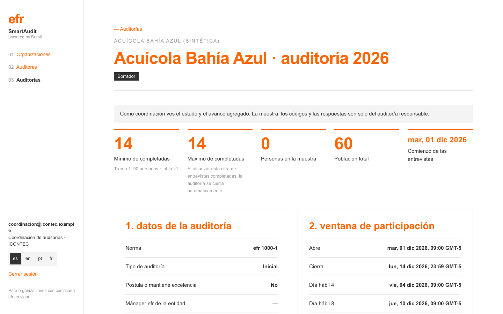

El coordinador ve el **estado y el avance** de las auditorías de sus organizaciones, pero **nunca la muestra, los
códigos ni las respuestas**: eso es solo del auditor responsable. El aviso gris lo explica en la propia pantalla.

---

## 4. Trabajo del auditor

### 15 · Mis organizaciones

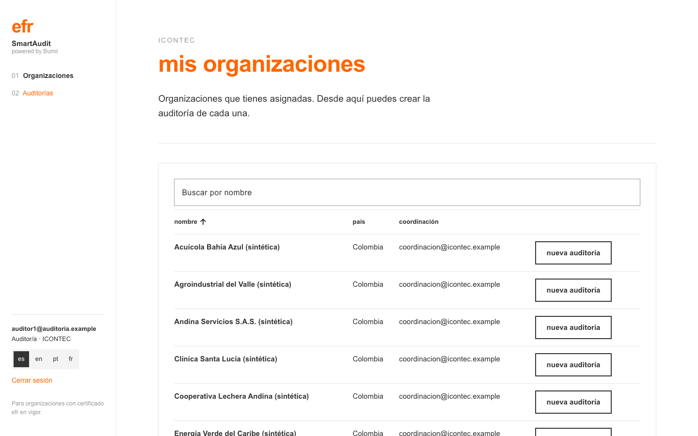

El auditor ve las organizaciones que su coordinador le ha asignado y, en cada fila, el botón **«nueva auditoría»**.

### 16 · Nueva auditoría con cálculo automático

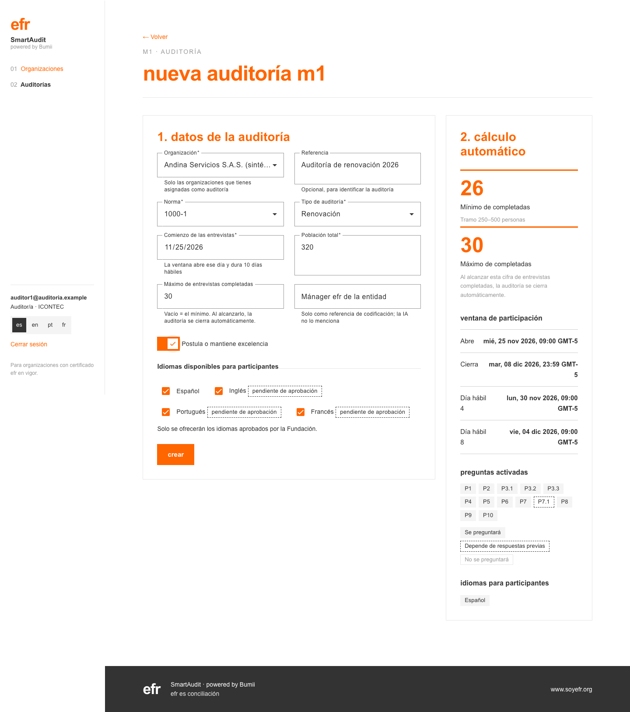

El auditor rellena los datos de la auditoría y el panel **«2. cálculo automático»** se actualiza al instante. En el
ejemplo, una renovación con 320 personas que postula a la excelencia:

- **Mínimo de completadas: 26** (tramo 250–500 de la tabla oficial).
- **Máximo de completadas: 30.** Por defecto es el mínimo; el auditor puede subirlo. Al alcanzarlo, la auditoría
  **se cierra automáticamente**.
- **Ventana de participación:** abre el **día de comienzo de las entrevistas** (25 de noviembre, 09:00) y dura **10 días
  hábiles**, hasta el 8 de diciembre a las 23:59, hora de Colombia. Los recordatorios caen en los días hábiles 4 y 8
  (30 de noviembre y 4 de diciembre).
- **Preguntas activadas:** P8 aparece porque es una renovación y P9 porque postula a la excelencia; P7.1 depende de la
  respuesta a P7.
- **Idiomas para participantes:** solo español, porque es el único aprobado.

Todos estos cálculos los hace la plataforma con reglas fijas y verificadas; **la IA no interviene**.

### 17 · Máximo no válido

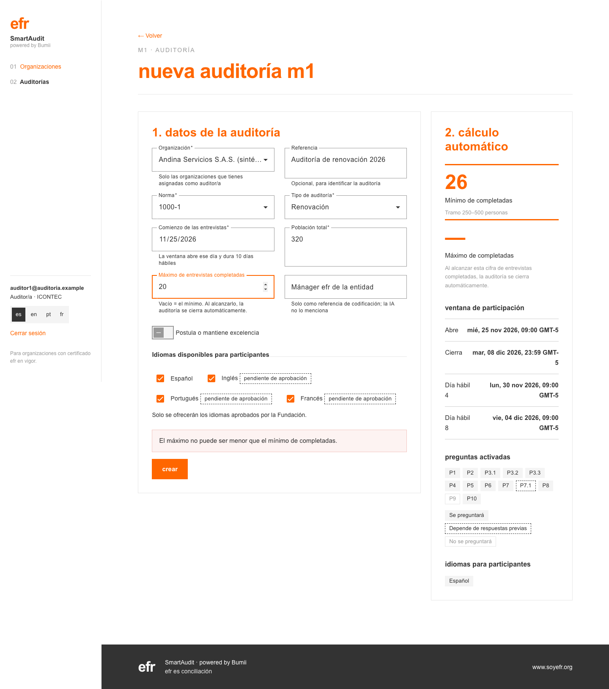

El máximo nunca puede quedar por debajo del mínimo (ni por encima de la población total o de la muestra cargada). Si
el auditor escribe 20 cuando el mínimo es 26, la plataforma lo avisa antes de crear la auditoría.

### 18 · Ficha de la auditoría en borrador

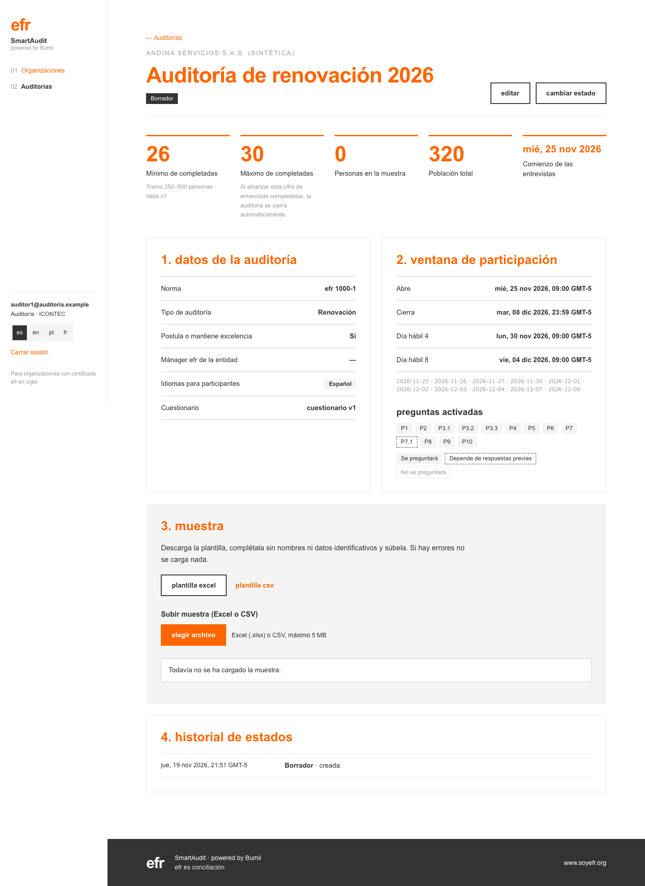

Resumen de la auditoría con cifras destacadas (mínimo, máximo, personas en la muestra, población total y comienzo de
las entrevistas), los datos de la auditoría, la ventana con todos los días hábiles, las preguntas que se harán, la
sección de **muestra** (todavía vacía) y el **historial de estados**.

### 19 · Muestra con errores

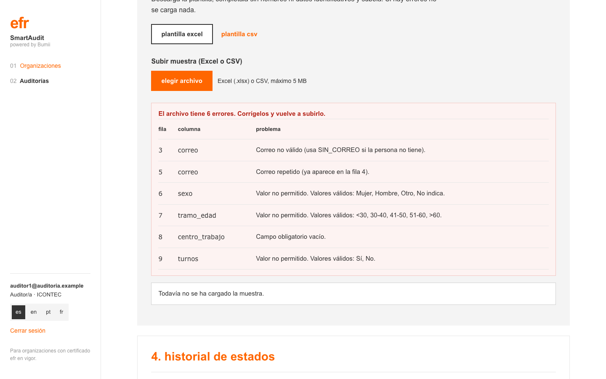

El auditor descarga la plantilla de muestra (Excel o CSV), la rellena **sin nombres ni datos identificativos** y la
sube. Si hay errores, la plataforma los muestra **fila a fila** y **no carga nada**: correo no válido o repetido, valores
fuera de las categorías permitidas, campos obligatorios vacíos… También rechaza columnas con datos prohibidos, como
nombre, DNI, salario o salud.

### 20 · Muestra cargada

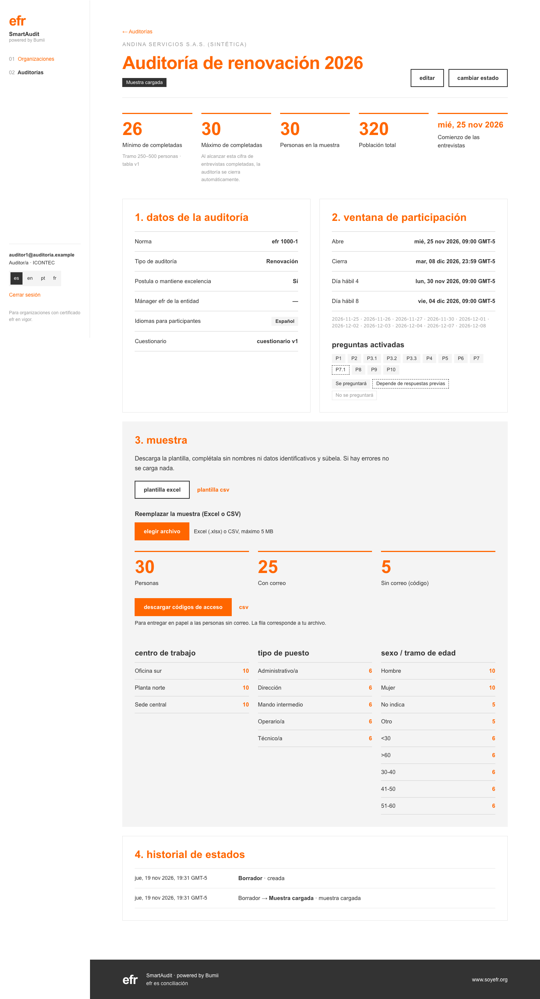

Con el archivo corregido, la auditoría pasa a **«Muestra cargada»** y aparece el botón **«lanzar auditoría»** (ver la
[Fase 2](fase-2.md)). El auditor ve:

- **Personas:** 30 en total, 25 con correo y 5 sin correo.
- **Códigos de acceso:** el botón para descargarlos e imprimirlos para las personas sin correo.
- **Distribución:** por centro de trabajo, tipo de puesto, sexo y tramo de edad, para revisar que la muestra es
  representativa.
- **Historial:** el cambio de estado queda registrado.

Si un grupo tiene menos de 3 personas, la plataforma avisa del riesgo de reidentificación.

### 21 · Auditorías abiertas

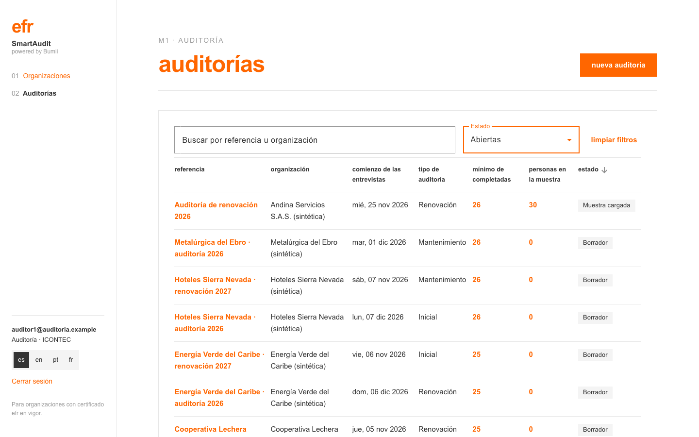

El listado de auditorías tiene buscador (por referencia u organización), **filtro de estado** («abiertas», «cerradas»
o un estado concreto), columnas ordenables y páginas. En el ejemplo, el filtro «abiertas» oculta las canceladas y las
que ya tienen informe.

---

## 5. Persona participante sin correo electrónico

### 22 · Introducir el código

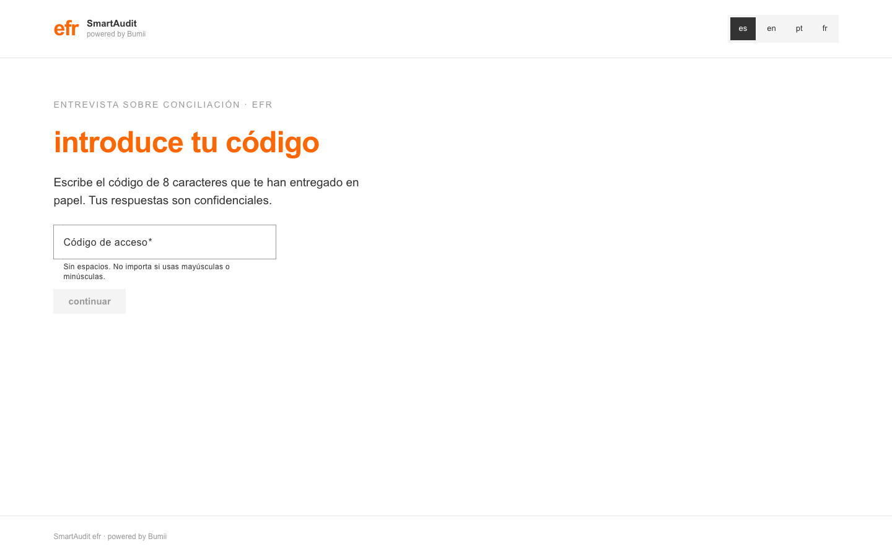

La persona abre el enlace que recibe impreso junto a su código y escribe el **código de 8 caracteres**. Da igual si
usa mayúsculas o minúsculas. Tras varios intentos fallidos, el acceso se bloquea unos minutos.

### 23 · Código correcto y aviso previo

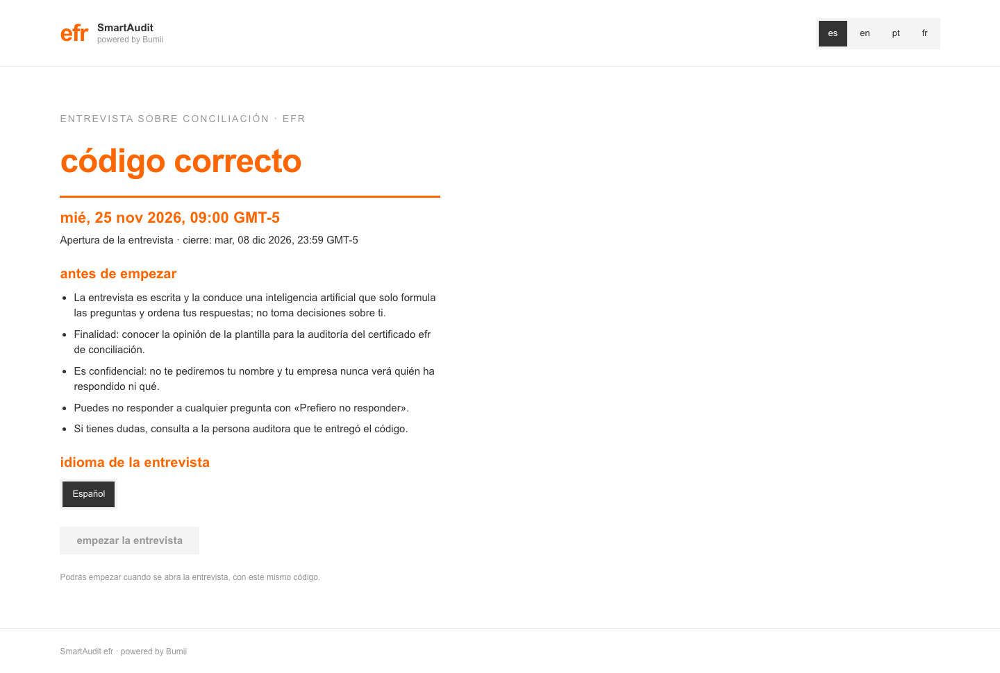

Con un código válido, la persona ve:

- **Fechas:** cuándo abre y cierra la entrevista.
- **Aviso previo:** uso de IA, finalidad, confidencialidad, derecho a no responder y a quién dirigirse.
- **Idioma:** la elección del idioma de la entrevista.

La empresa nunca sabrá quién ha respondido ni qué. En el ejemplo la entrevista todavía no está abierta, así que el botón
«empezar la entrevista» espera a la fecha de comienzo; cuando se abre, lleva a la entrevista (ver la [Fase 2](fase-2.md)).

### 24 · Vista en el móvil


La misma pantalla en un teléfono. El área del participante está pensada para responder desde el móvil.

---

## 6. Otras capacidades

### 25 · Superadmin: todas las auditorías

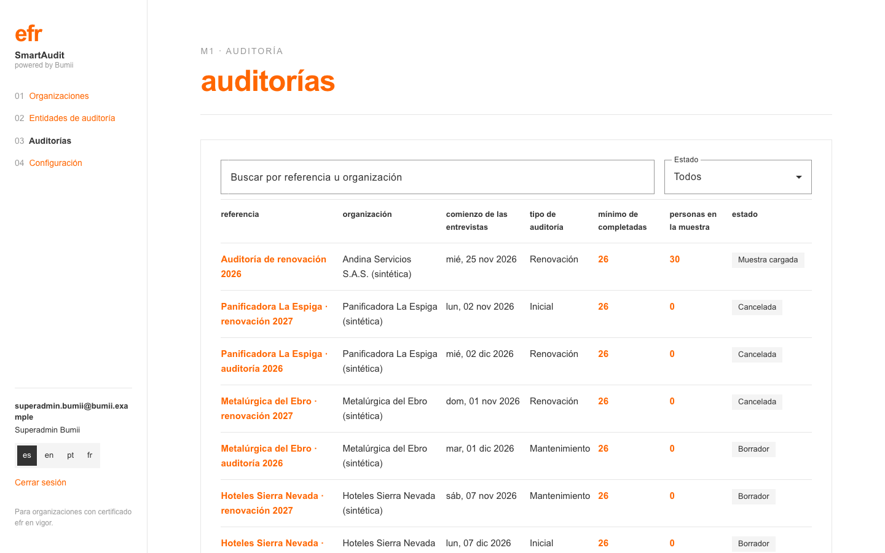

Los superadministradores ven las auditorías de **todas las organizaciones y entidades**, con el mismo buscador, filtro de
estado y páginas, y pueden suspenderlas o cancelarlas.

### 26 · Plataforma en francés

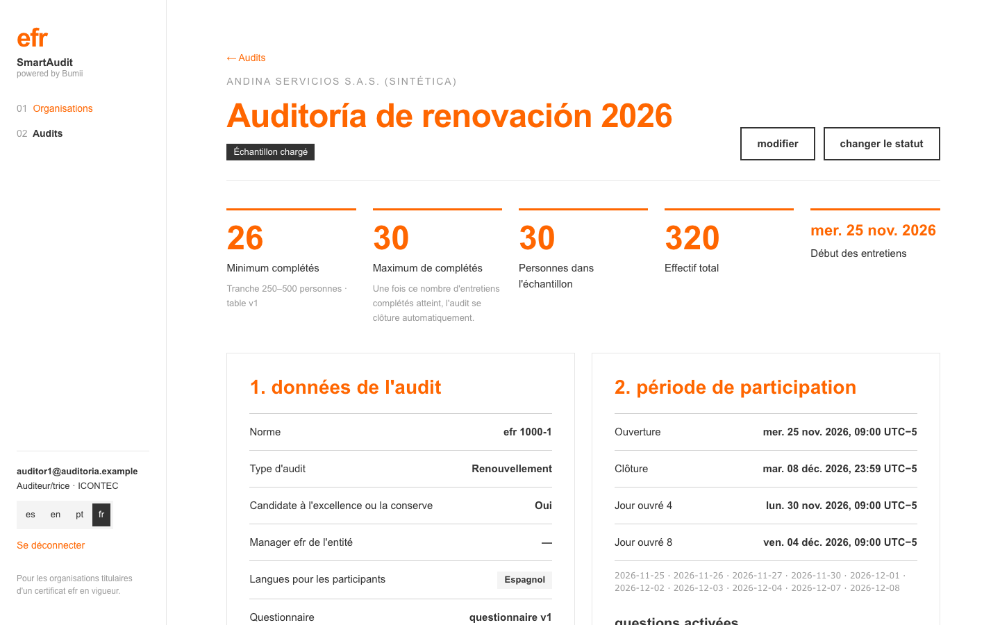

La misma ficha de auditoría con la interfaz en francés: textos, fechas y estados («Échantillon chargé»). Ningún texto
está escrito directamente en el código, así que añadir o retirar idiomas no requiere reprogramar.

### 27 · Correo de acceso con la marca efr


El correo con el enlace de acceso, con la identidad visual efr: naranja corporativo, títulos en minúsculas,
«powered by Bumii», el claim «efr es conciliación» y el enlace a www.soyefr.org. Se envía en el idioma de cada
persona.

---

## Cómo regenerar las capturas

Con la plataforma en local recién arrancada (`npm run dev:local` y `npm start -w apps/web`):

```bash
npm run screenshots
```

El guion (`e2e/presentation/screenshots.spec.ts`) crea los datos de demostración (28 organizaciones y unas 30
auditorías sintéticas) y vuelve a generar todas las imágenes de `docs/presentacion/img/`. Los cambios de la plataforma
que todavía no estén en las capturas se numeran en [`cambios-pendientes.md`](cambios-pendientes.md).
