# SmartAudit efr · avances de la plataforma

**Estado:** Fase 1 completada (base, configuración y muestra) y página de acceso con código adelantada de la Fase 2.
**Fecha de las capturas:** 13 de noviembre de 2026.
**Servidor de pruebas:** https://efr-staging.bumii.ai

> **Desactualizada desde el 18/11/2026:** la plataforma ha cambiado después de estas capturas. Los cambios que faltan
> están numerados en [`cambios-pendientes.md`](cambios-pendientes.md) y se aplicarán al rehacer las capturas.

Las imágenes están en [`img/`](img/) y muestran la plataforma real con **datos sintéticos**: organizaciones,
personas y correos ficticios. Siguen el orden de un recorrido completo: acceso, superadministración,
administración de la organización, trabajo del auditor y acceso de una persona participante.

---

## Resumen para la presentación

| Qué ya funciona | Qué viene después |
|---|---|
| Acceso sin contraseñas por enlace de un solo uso, en 5 idiomas | Envío de invitaciones y recordatorios por correo (Fase 2) |
| Gestión de organizaciones, administradores y auditores | Entrevista escrita conducida por IA (Fase 2) |
| Configuración versionada: tabla de mínimos y cuestionario M1 | Revisión de respuestas dudosas y resultados (Fase 3) |
| Campañas con cálculo automático del mínimo, la ventana y las preguntas | Informe de auditoría en Word, Excel y PDF (Fase 3) |
| Carga de la muestra con validación fila a fila y códigos para personas sin correo | Piloto real y puesta en producción (Fase 4) |
| Página pública para que las personas sin correo entren con su código | |
| Marca efr aplicada en toda la interfaz, los correos y los Excel | |

---

## 1. Acceso a la plataforma

### 01 · Pantalla de acceso

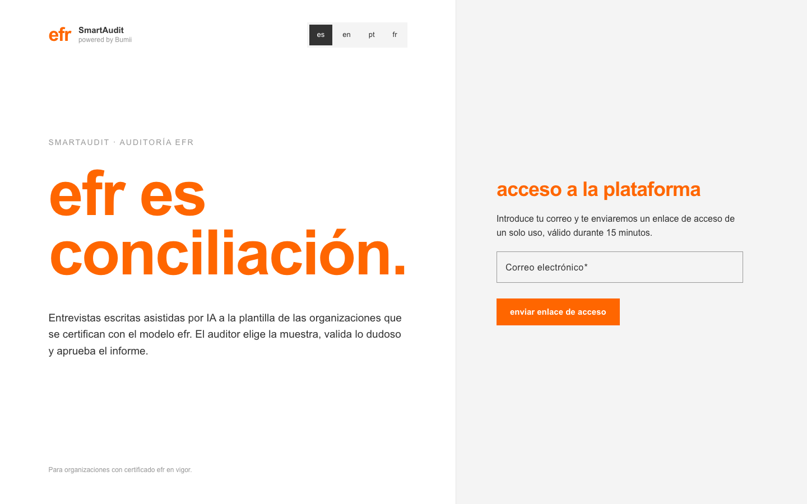

Portada con el claim de la marca **«efr es conciliación.»**. No hay contraseñas: la persona escribe su correo y recibe
un **enlace de acceso de un solo uso, válido 15 minutos**. Arriba se elige el idioma de la interfaz: español, inglés,
catalán, portugués de Portugal o francés.

### 02 · Enlace de acceso en pantalla (entorno de pruebas)

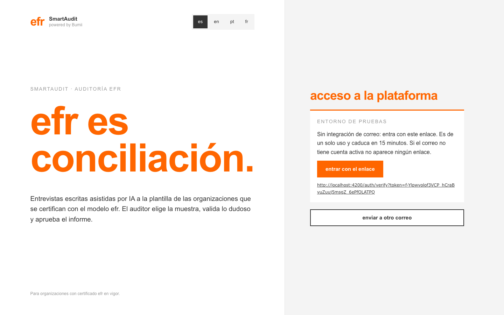

Como el entorno de pruebas aún no está conectado al correo, el enlace aparece directamente en pantalla con el botón
**«entrar con el enlace»**. En producción llegará por correo electrónico y esta opción no existirá.

### 03 · Elección de organización

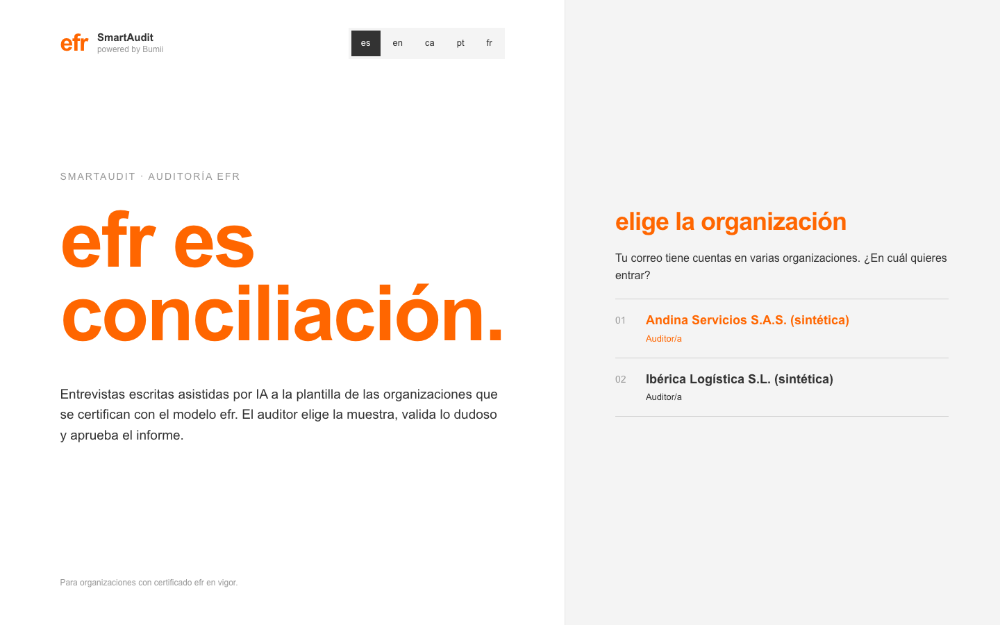

Una misma persona puede trabajar para varias organizaciones; por ejemplo, un auditor que audita dos empresas. Al
entrar elige en cuál trabajar, y la plataforma **mantiene la información de cada organización separada**.

---

## 2. Superadministración (Bumii y Fundación Másfamilia)

### 04 · Organizaciones

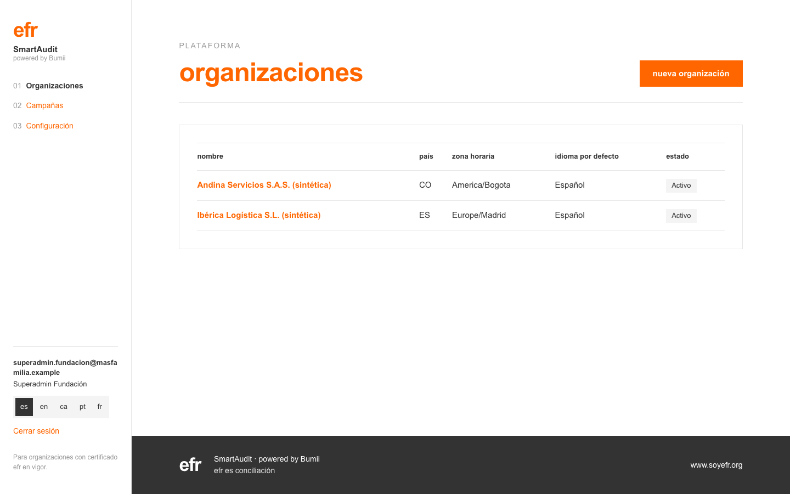

Listado de las empresas efr dadas de alta, con país, zona horaria e idioma por defecto. La zona horaria marca **a qué
hora local** abren y cierran las entrevistas. Desde aquí se crea una
nueva organización junto con su administrador.

### 05 · Ficha de una organización

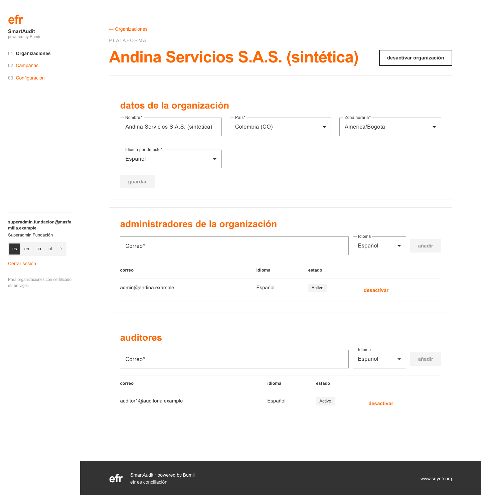

Datos de la organización y gestión de sus **administradores** y **auditores**: alta por correo, idioma preferido, y
activar o desactivar. La persona dada de alta recibe un aviso por correo.

### 06 · Tabla de mínimos de entrevistas

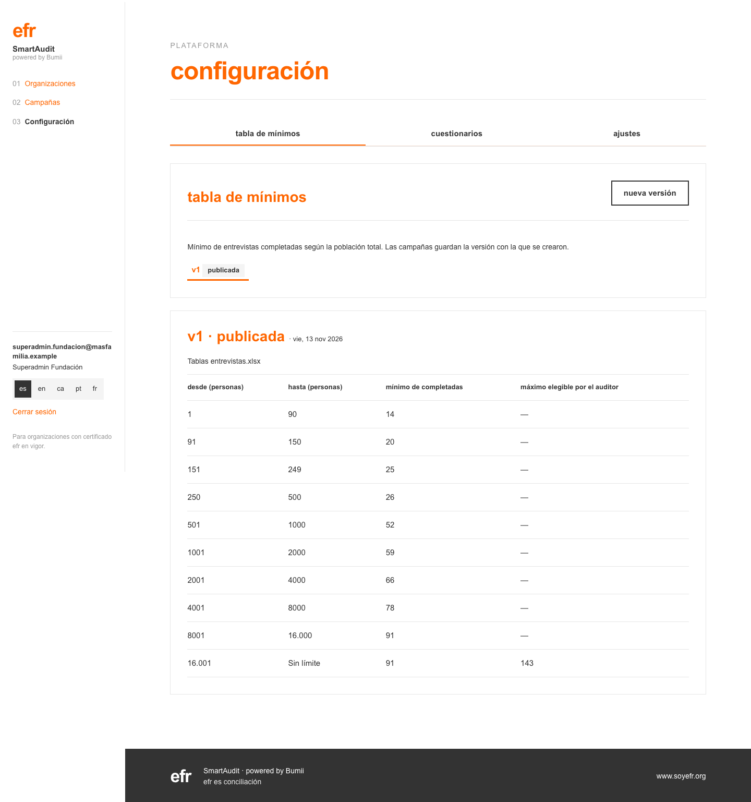

La tabla oficial (*Tablas entrevistas.xlsx*) que fija el **mínimo de entrevistas completadas** según la población
total: de 14 (hasta 90 personas) a 91 (hasta 16.000). Por encima de 16.000, el auditor fija la cifra entre 91 y 143.
Está **versionada**: una versión publicada no se modifica y cada campaña conserva la versión con la que se creó.

### 07 · Cuestionario oficial M1

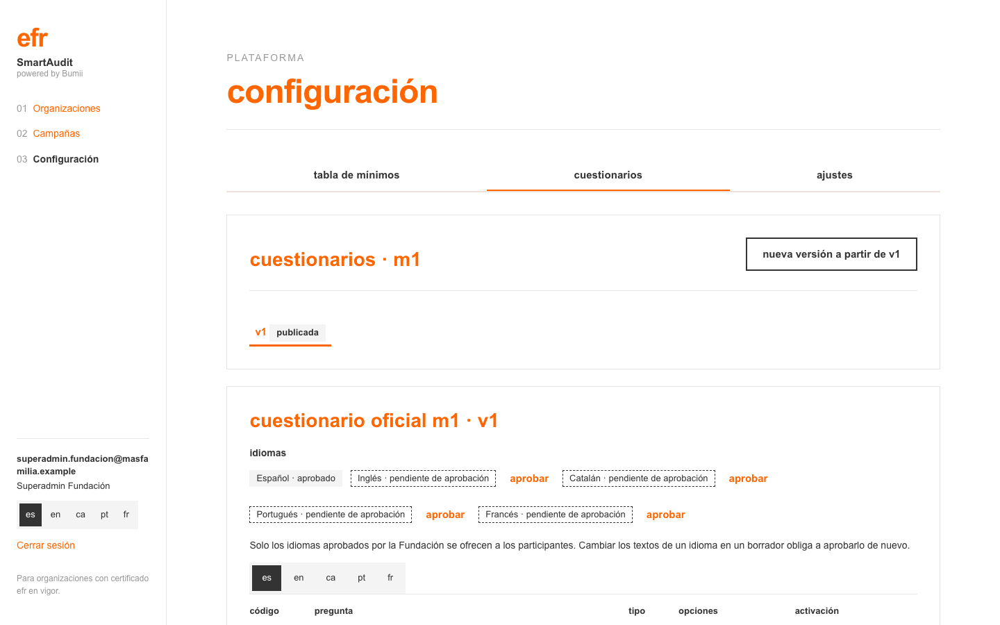

El cuestionario oficial (P1 a P10) con sus textos en los cinco idiomas. El español está **aprobado**; inglés, catalán,
portugués y francés están **pendientes de aprobación por la Fundación** y no se ofrecerán a las personas participantes
hasta que se aprueben con el botón «aprobar». Más abajo se ven las preguntas, sus opciones y sus **reglas de
activación**: por ejemplo, P8 solo en renovaciones y P9 solo si se postula a la excelencia.

### 08 · Ajustes

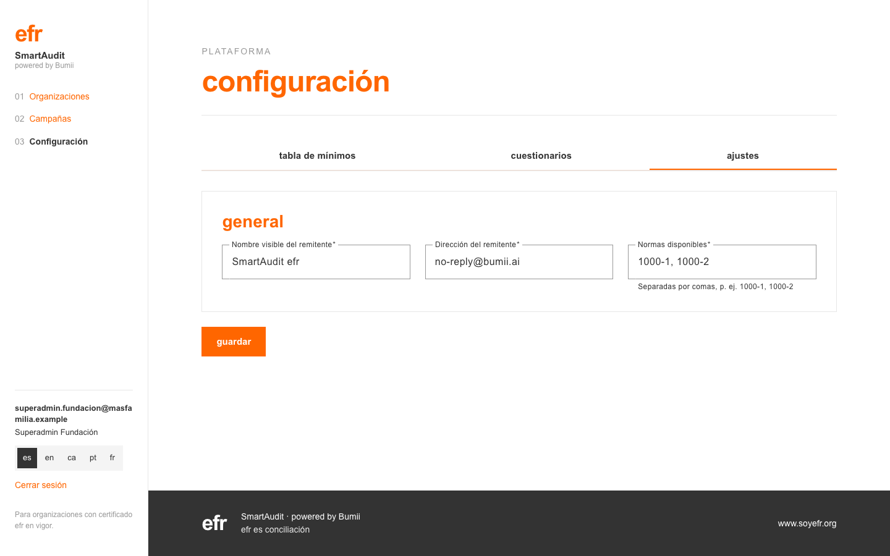

Ajustes generales de la plataforma: el nombre y la dirección del remitente de los correos, y las normas disponibles
al crear una campaña (efr 1000-1 y 1000-2).

---

## 3. Administración de la organización (empresa efr)

### 09 · Auditores de la organización

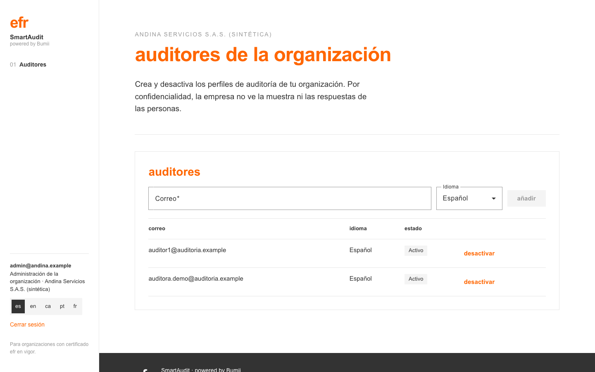

El administrador de la empresa da de alta y desactiva a sus auditores. **Por confidencialidad, la empresa no ve
nunca la muestra ni las respuestas de las personas**, solo gestiona quién audita.

---

## 4. Trabajo del auditor

### 10 · Campañas del auditor

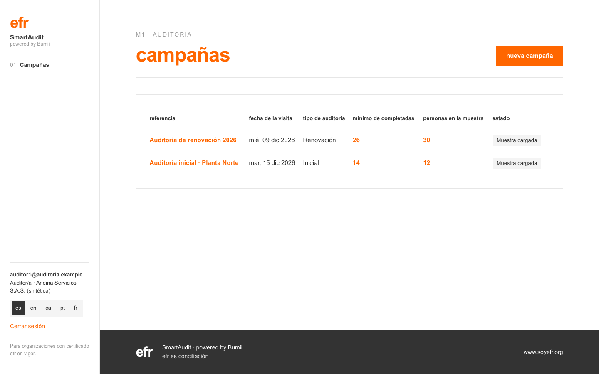

Cada auditoría es una **campaña**. El listado muestra la fecha de la visita, el tipo de auditoría, el **mínimo de
entrevistas completadas** exigido, las personas cargadas en la muestra y el estado.

### 11 · Nueva campaña con cálculo automático

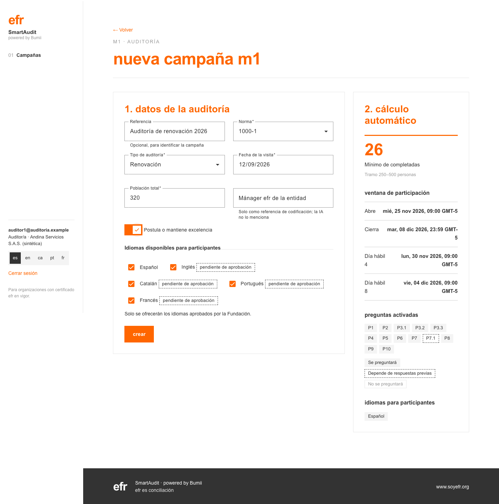

El auditor rellena los datos de la auditoría y el panel **«2. cálculo automático»** se actualiza al instante. En el
ejemplo, una renovación con 320 personas que postula a la excelencia:

- **Mínimo de completadas: 26** (tramo 250–500 de la tabla oficial).
- **Ventana de participación:** abre el 25 de noviembre a las 09:00 y cierra el 8 de diciembre a las 23:59, hora de
  Colombia. Son los 10 días hábiles (de lunes a viernes) previos a la visita. Los recordatorios caen en los días
  hábiles 4 y 8 (30 de noviembre y 4 de diciembre).
- **Preguntas activadas:** P8 aparece porque es una renovación y P9 porque postula a la excelencia; P7.1 depende de la
  respuesta a P7.
- **Idiomas para participantes:** solo español, porque es el único aprobado.

Todos estos cálculos los hace la plataforma con reglas fijas y verificadas; **la IA no interviene**.

### 12 · Ficha de la campaña en borrador

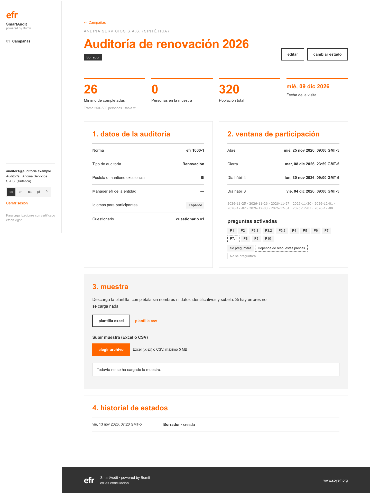

Resumen de la campaña con cifras destacadas, los datos de la auditoría, la ventana con todos los días hábiles, las
preguntas que se harán, la sección de **muestra** (todavía vacía) y el **historial de estados**.

### 13 · Muestra con errores

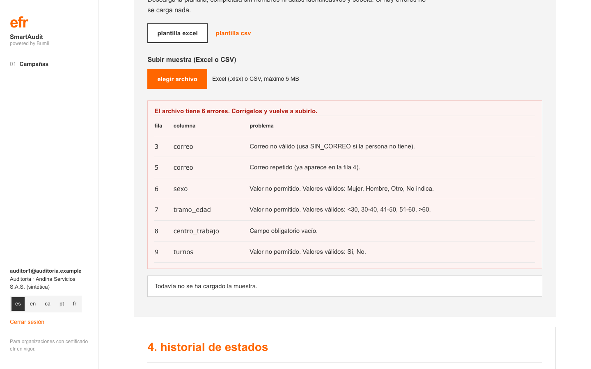

El auditor descarga la plantilla de muestra (Excel o CSV), la rellena **sin nombres ni datos identificativos** y la
sube. Si hay errores, la plataforma los muestra **fila a fila** y **no carga nada**: correo no válido o repetido, valores
fuera de las categorías permitidas, campos obligatorios vacíos… También rechaza columnas con datos prohibidos, como
nombre, DNI, salario o salud.

### 14 · Muestra cargada

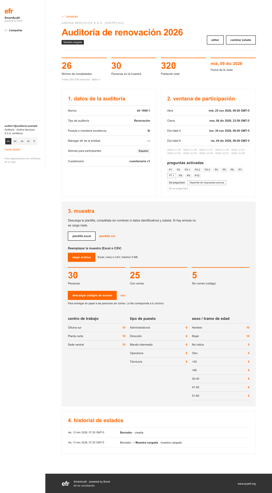

Con el archivo corregido, la campaña pasa a **«Muestra cargada»**. El auditor ve:

- **Personas:** 30 en total, 25 con correo y 5 sin correo.
- **Códigos de acceso:** el botón para descargarlos e imprimirlos para las personas sin correo.
- **Distribución:** por centro de trabajo, tipo de puesto, sexo y tramo de edad, para revisar que la muestra es
  representativa.
- **Historial:** el cambio de estado queda registrado.

Si un grupo tiene menos de 3 personas, la plataforma avisa del riesgo de reidentificación.

---

## 5. Persona participante sin correo electrónico

### 15 · Introducir el código

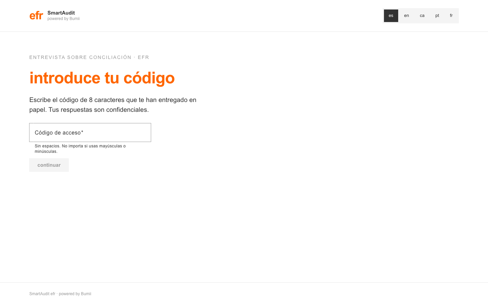

La persona abre el enlace que recibe impreso junto a su código y escribe el **código de 8 caracteres**. Da igual si usa mayúsculas o minúsculas. Tras varios intentos fallidos, el acceso se bloquea unos
minutos.

### 16 · Código correcto y aviso previo

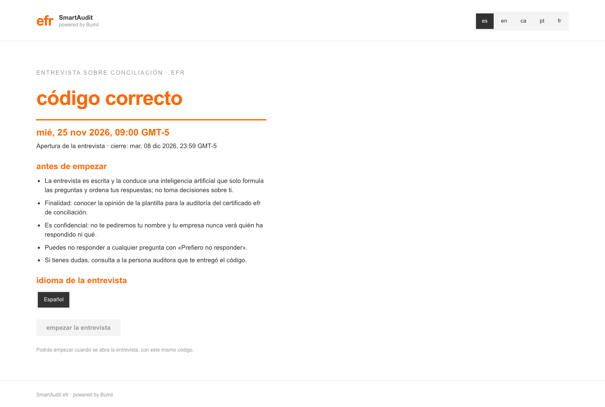

Con un código válido, la persona ve:

- **Fechas:** cuándo abre y cierra la entrevista.
- **Aviso previo:** uso de IA, finalidad, confidencialidad, derecho a no responder y a quién dirigirse.
- **Idioma:** la elección del idioma de la entrevista.

La empresa nunca sabrá quién ha respondido ni qué. El botón «empezar la entrevista» se activará en la **Fase 2**, cuando
esté lista la entrevista con IA.

### 17 · Vista en el móvil

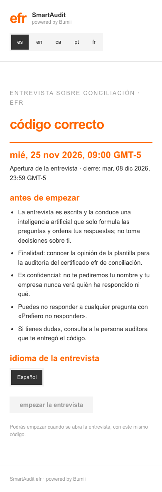

La misma pantalla en un teléfono. El área del participante está pensada para responder desde el móvil.

---

## 6. Otras capacidades

### 18 · Superadmin: todas las campañas

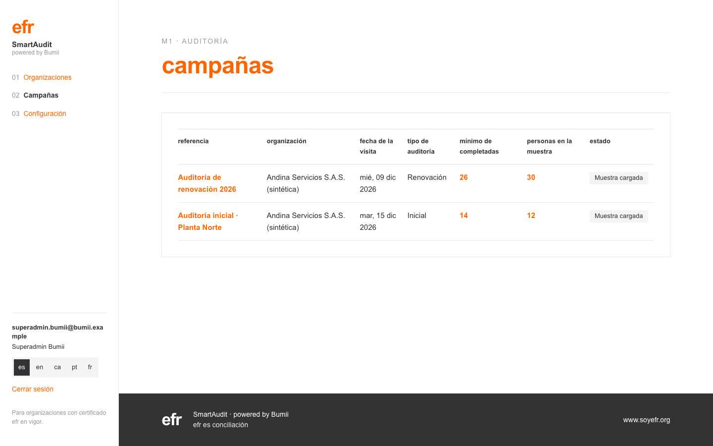

Los superadministradores ven las campañas de todas las organizaciones, con una columna adicional de organización, y
pueden suspenderlas o cancelarlas.

### 19 · Plataforma en francés

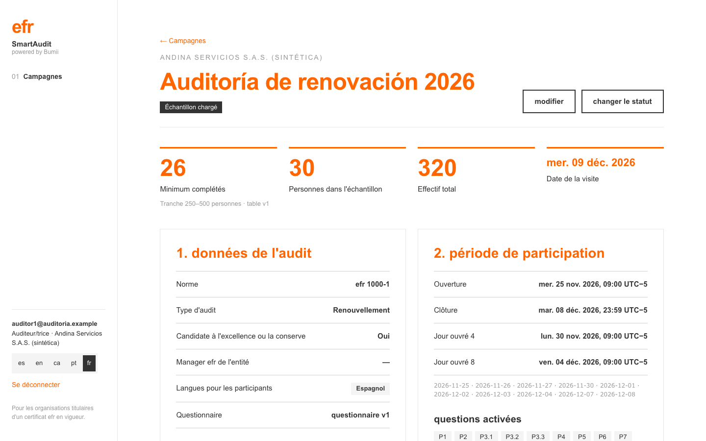

La misma ficha de campaña con la interfaz en francés: textos, fechas («mer. 09 déc. 2026») y estados («Échantillon
chargé»). Ningún texto está escrito directamente en el código, así que añadir idiomas no requiere reprogramar.

### 20 · Correo de acceso con la marca efr

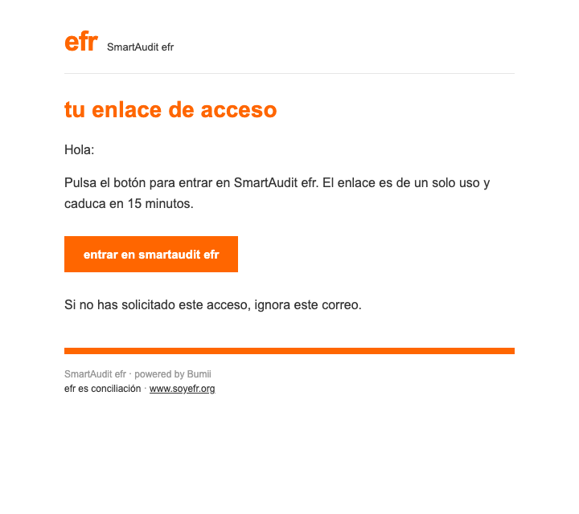

El correo con el enlace de acceso, con la identidad visual efr: naranja corporativo, títulos en minúsculas,
«powered by Bumii», el claim «efr es conciliación» y el enlace a www.soyefr.org. Se envía en el idioma de cada
persona.

---

## Cómo regenerar las capturas

Con la plataforma en local recién arrancada (`npm run dev:local` y `npm start -w apps/web`):

```bash
npm run screenshots
```

El guion (`e2e/presentation/screenshots.spec.ts`) crea los datos de demostración y vuelve a generar todas las imágenes
de `docs/presentacion/img/`.
