# SmartAudit efr · cambios #3

**Fecha:** 25 de noviembre de 2026
**Para:** Fundación Másfamilia (F+f) y equipo Bumii
**Versión en el servidor de pruebas:** https://efr-staging.bumii.ai (cuestionario M1 versión 3)
**Capturas:** [`img/cambios3/`](img/cambios3/) · presentaciones anteriores: [Fase 1](README.md), [Fase 2](fase-2.md)

Este informe recoge los cambios hechos a partir de los comentarios de la Fundación del 25 de noviembre, en dos bloques:

- **A · Grupo de cambios 3:** tipos de auditoría, componente de Bienestar, máximo de entrevistas y auditorías sin
  activación manual.
- **B · Entrevista conversada:** la respuesta a la pregunta de la Fundación sobre cómo debe interactuar la IA con las
  personas entrevistadas.

Las capturas se hicieron en el **servidor de pruebas con la IA real (Google Gemini)** y **datos sintéticos**: la
organización, las personas y las respuestas son ficticias. Por eso los mensajes de la IA son los que vería una persona
de verdad: pueden variar ligeramente de una entrevista a otra, pero siempre dentro de los límites que fija el código.

---

## En una página

| # | Qué se pidió | Qué hace ahora la plataforma | Capturas |
|---|---|---|---|
| A1 | Tipo de auditoría solo **inicial o renovación** | El desplegable ofrece solo esas dos opciones («mantenimiento» se conserva únicamente en auditorías antiguas) | 01, 02 |
| A2 | Casilla de **Bienestar** que active P11–P15 | Al marcarla, las preguntas P11 a P15 pasan a «se preguntará» y aparecen en la entrevista antes de P10 | 02, 14, 15 |
| A3 | Corregir que al editar no se pudiera fijar un **máximo mayor que el mínimo** | El máximo ya no lo limita la muestra cargada, solo la población total; la ficha avisa si supera la muestra | 03, 04 |
| A4 | **Sin activar ni desactivar** auditorías | Con la muestra cargada la auditoría queda programada y se abre sola el día de comienzo; no hay «lanzar», «suspender» ni «cancelar» | 04, 05, 06, 07 |
| B1 | Que no se pueda responder **marcando un check** | Las preguntas cerradas se responden siempre por escrito; solo queda el botón «Prefiero no responder» | 08 |
| B2 | Que la IA **pregunte proponiendo las respuestas** | Cada pregunta oficial termina con una frase que propone todas las respuestas («Puede responder que sí, que no o que no lo sabe») | 08, 14 |
| B3 | Que la IA **repregunte, aclare o converse** ante respuestas incoherentes, **dos veces como máximo** | La IA explica lo que la persona no entiende, propone su interpretación para que la confirme, pide concretar o reconduce; hasta dos veces por pregunta | 09–13, 18 |
| B4 | (Ejemplo de la Fundación) quien no conoce el modelo efr quedaba como **abstención** | Nueva opción de P2 «No he recibido información»; se registra como respuesta válida | 19 |

---

## A · Grupo de cambios 3

### 01 · Tipo de auditoría: inicial o renovación

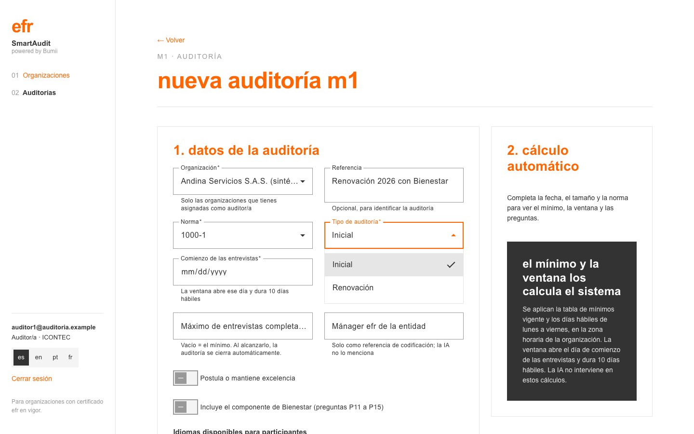

Al crear una auditoría, el tipo solo puede ser **«Inicial»** o **«Renovación»**. El tipo sigue decidiendo qué preguntas
se hacen: P8 («¿En los últimos años se han mejorado las condiciones…?») solo en renovación.

### 02 · Nueva auditoría con el componente de Bienestar

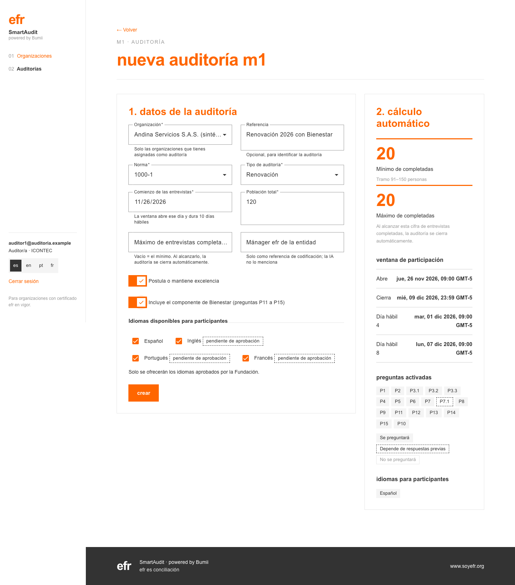

Nueva casilla **«Incluye el componente de Bienestar (preguntas P11 a P15)»**. A la derecha, el cálculo automático
muestra al momento qué preguntas se harán: con Bienestar marcado, **P11, P12, P13, P14 y P15** aparecen como «se
preguntará». En esta renovación con excelencia también se activan P8 y P9; P7.1 depende de lo que la persona responda
en P7.

### 03 · Editar el máximo por encima de la muestra (fallo corregido)

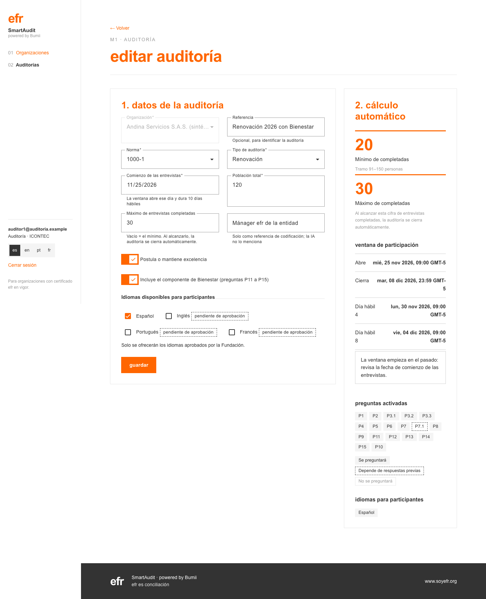

La auditoría tiene 12 personas en la muestra y un mínimo de 20. Antes, al editarla, la plataforma no dejaba fijar un
máximo mayor que la muestra cargada (aunque al crearla sí lo aceptaba). Ahora el máximo solo está limitado por la
población total: aquí se fija en **30**.

*Nota:* el aviso «La ventana empieza en el pasado» aparece porque la captura se hizo por la tarde con la fecha de
comienzo de hoy (la ventana abre a las 9:00).

### 04 · Auditoría programada, sin botón de activar

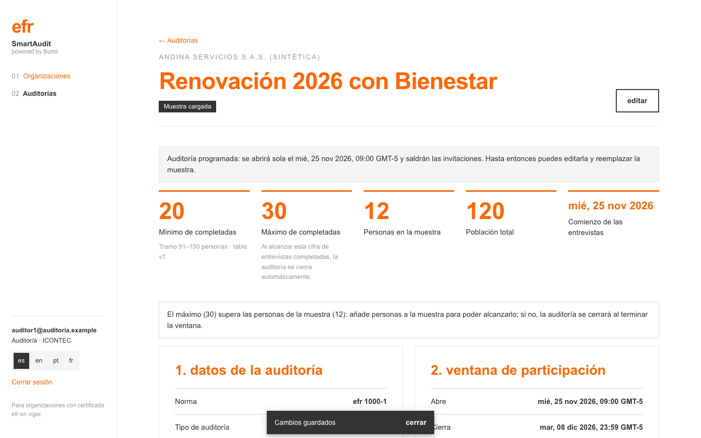

Con la muestra cargada, la ficha ya no muestra «lanzar auditoría» ni el menú «cambiar estado». En su lugar, un aviso:
**«Auditoría programada: se abrirá sola el … y saldrán las invitaciones. Hasta entonces puedes editarla y reemplazar la
muestra.»** Debajo, el aviso del máximo: **30 supera las 12 personas de la muestra**; se pueden añadir personas para
alcanzarlo o la auditoría se cerrará al terminar la ventana.

### 05 · La ficha completa de la auditoría programada

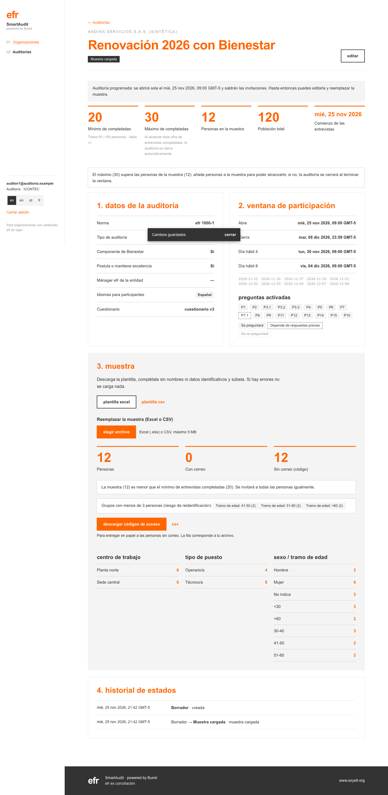

Vista completa: datos de la auditoría (con la fila **«Componente de Bienestar»**), ventana de participación,
recordatorios, muestra cargada y códigos para las personas sin correo.

### 06 · Se abre sola el día de comienzo

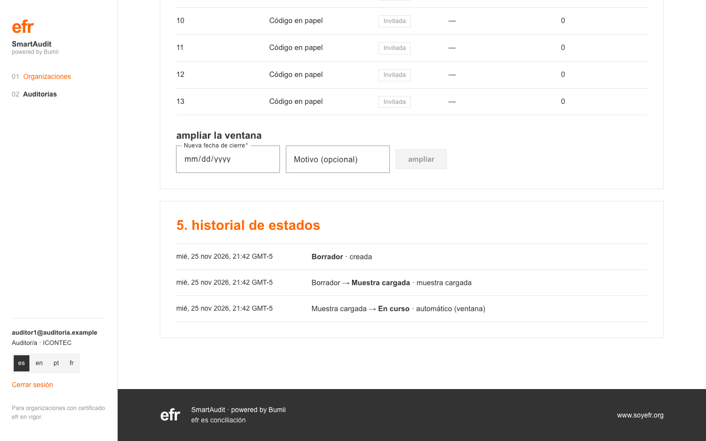

Sin que nadie pulse nada, la auditoría pasó a **«En curso»** al llegar su fecha de comienzo. El historial lo muestra:
*Borrador → Muestra cargada → En curso · automático (ventana)*. Del mismo modo se cerrará sola al terminar la ventana
o al alcanzar el máximo.

### 07 · Estados del listado

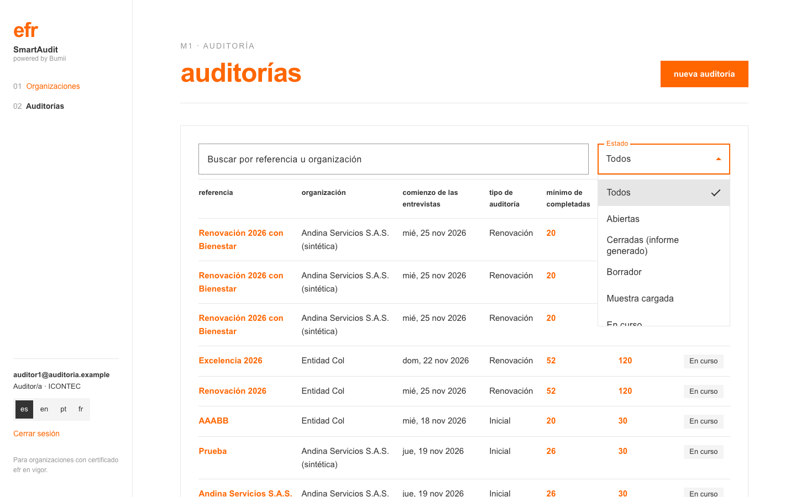

El filtro de estado de las auditorías ya no ofrece «Envíos activos», «Suspendida» ni «Cancelada».

---

## B · Entrevista conversada

**La propuesta de la Fundación.** Responder solo con opciones cerradas se parecía más a rellenar un formulario que a
una entrevista de auditor, y en el ejemplo probado la IA no reaccionaba: ante «¿Qué modelo es el efr?» solo repetía
«Por favor, responda de nuevo a la pregunta».

**Cómo queda.** La IA sigue **acotada**: el orden de las preguntas, cuándo y por qué se repregunta, el límite de dos
interacciones y la codificación los decide el código. Dentro de esos límites, la IA **conversa**:

| Situación | Qué hace la IA | Captura |
|---|---|---|
| La persona pregunta qué significa algo | Explica **solo con el texto aprobado** de esa pregunta y vuelve a preguntar | 09, 10, 18 |
| La respuesta parece una opción, pero no está clara | **Propone su interpretación** y pide que la confirme o corrija | 11, 13 |
| La respuesta habla de otra cosa | Agradece y **reconduce** a la pregunta | 12 |
| La respuesta no encaja con ninguna opción | Recoge lo dicho y **pide concretar**, recordando las opciones | — |

Tras **dos interacciones** sin respuesta clara, la pregunta queda para **revisión del auditor**. Toda repregunta pasa
por un filtro automático: no puede sugerir una sola opción (salvo la interpretación que se propone confirmar), ni
traer cifras o datos que no estén en los textos aprobados; si no lo cumple, se usa un texto por defecto aprobado.

### 08 · Pregunta sin botones, con las respuestas propuestas

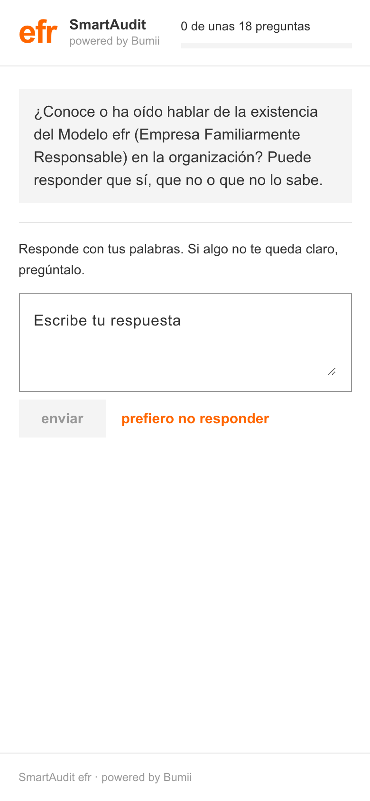

La pregunta es el **texto oficial** del cuestionario seguido de una frase que **propone todas las respuestas** («Puede
responder que sí, que no o que no lo sabe»). Ya no hay botones de opción: la persona escribe con sus palabras, y una
indicación la invita a preguntar lo que no entienda. Solo queda el botón **«Prefiero no responder»**, que es un
derecho de la persona.

La IA ya no reformula las preguntas oficiales, así que su sentido no puede cambiar. Antes se había visto, por ejemplo,
«importante» convertido en «fundamental».

### 09 · La persona pregunta y la IA explica

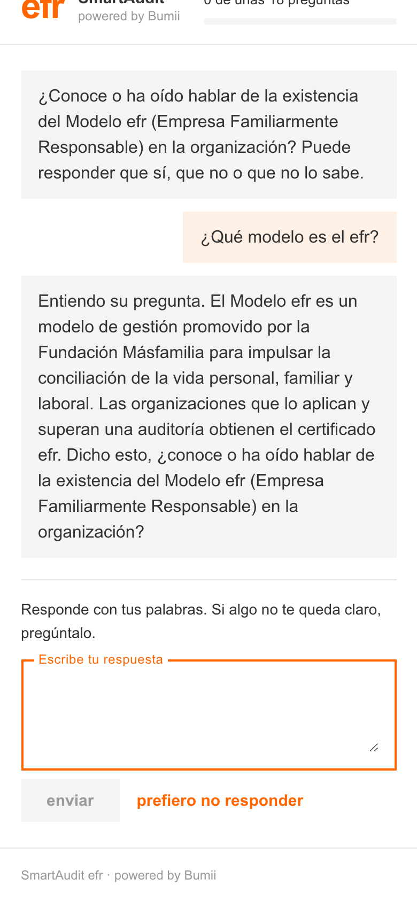

Es el ejemplo de la Fundación. A «¿Qué modelo es el efr?», la IA responde con la **explicación aprobada** del Modelo
efr y vuelve a hacer la pregunta. La IA no puede dar información que no esté en ese texto.
Versión de página completa: [`09b`](img/cambios3/09b-movil-explicacion-aprobada-completa.png).

### 10 · «¿Qué es un mánager efr?»

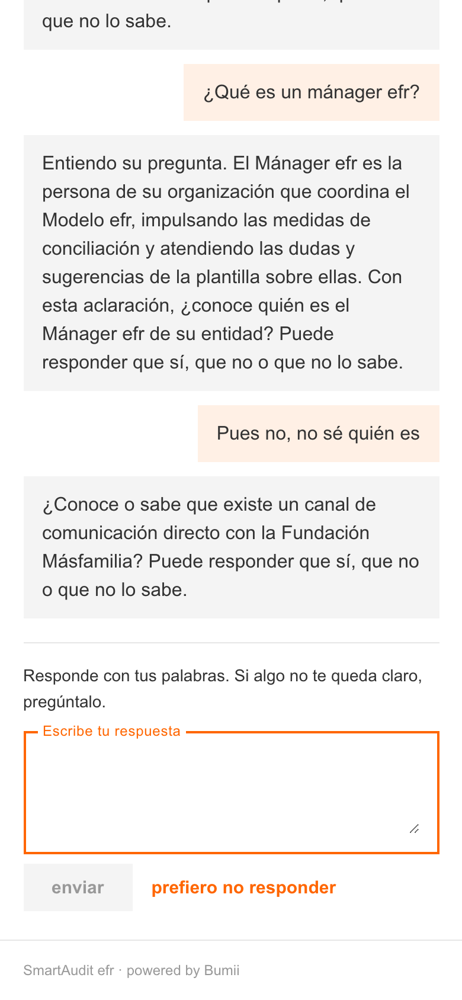

Lo mismo con P3.1: la IA explica qué es el Mánager efr y, cuando la persona responde «Pues no, no sé quién es», la
respuesta queda registrada como **«No»** y la entrevista sigue con P3.2.

### 11 · Confirmar una respuesta dudosa

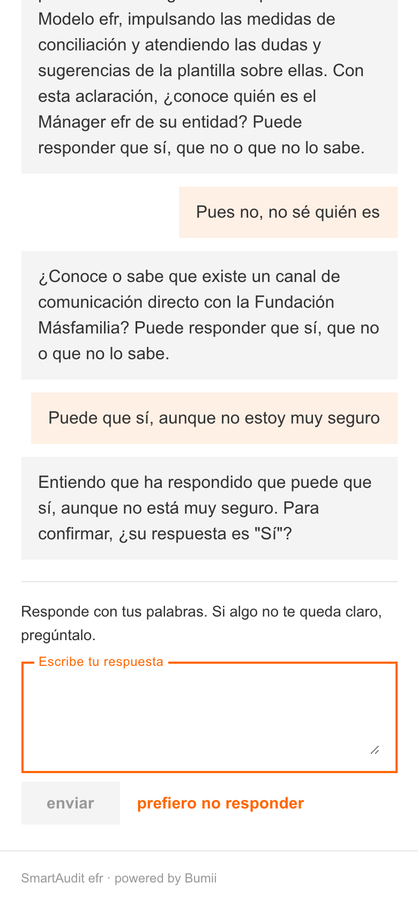

«Puede que sí, aunque no estoy muy seguro» no es un sí claro. La IA **propone su interpretación** («¿su respuesta es
"Sí"?») y la persona la confirma o la corrige. Así la respuesta queda registrada sin adivinar y sin mandarla
innecesariamente a revisión.

### 12 · Reconducir un comentario ajeno

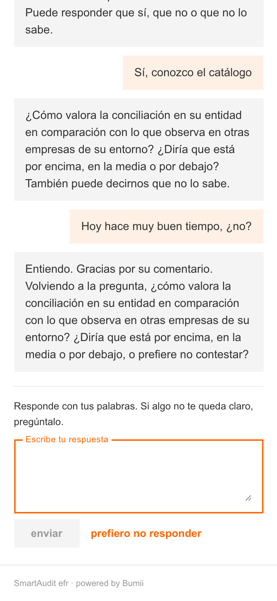

A «Hoy hace muy buen tiempo, ¿no?», la IA agradece el comentario sin entrar en él y vuelve a la pregunta, con sus
opciones.

### 13 · Interpretar una respuesta matizada

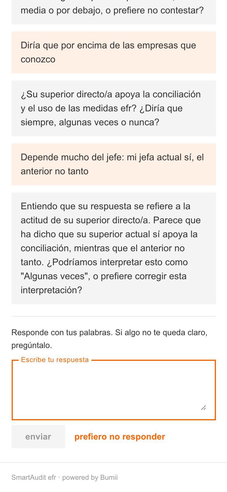

«Depende mucho del jefe: mi jefa actual sí, el anterior no tanto». La IA **resume lo que ha entendido** y propone
«Algunas veces», invitando a corregir. Es la conversación que la Fundación pedía: la IA reacciona a lo que dice la
persona en lugar de repetir la pregunta.

### 14 · Bienestar: escala de acuerdo

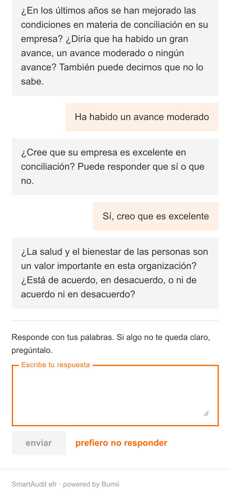

En una auditoría con Bienestar, tras P9 llega **P11**, con su frase de respuestas: «¿Está de acuerdo, en desacuerdo, o
ni de acuerdo ni en desacuerdo?».

### 15 · Bienestar: preguntas abiertas

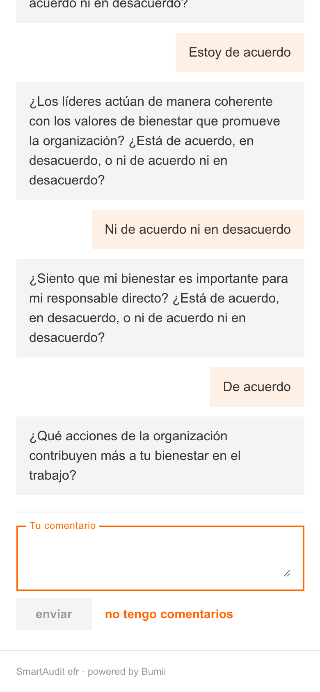

P14 y P15 son **preguntas abiertas y opcionales**: la persona escribe lo que quiera o pulsa «No tengo comentarios».
En la Fase 3 se mostrarán al auditor **sin vínculo con los datos demográficos** («texto libre disociado»).

### 16 · Fin de la entrevista

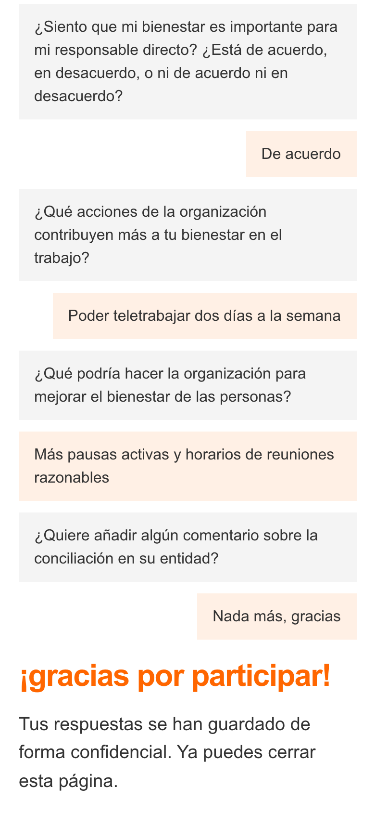

Última pregunta (P10, comentario sobre la conciliación) y agradecimiento. Versión de página completa con toda la
conversación: [`17`](img/cambios3/17-movil-conversacion-completa.png).

### 18 · La conversación en el ordenador

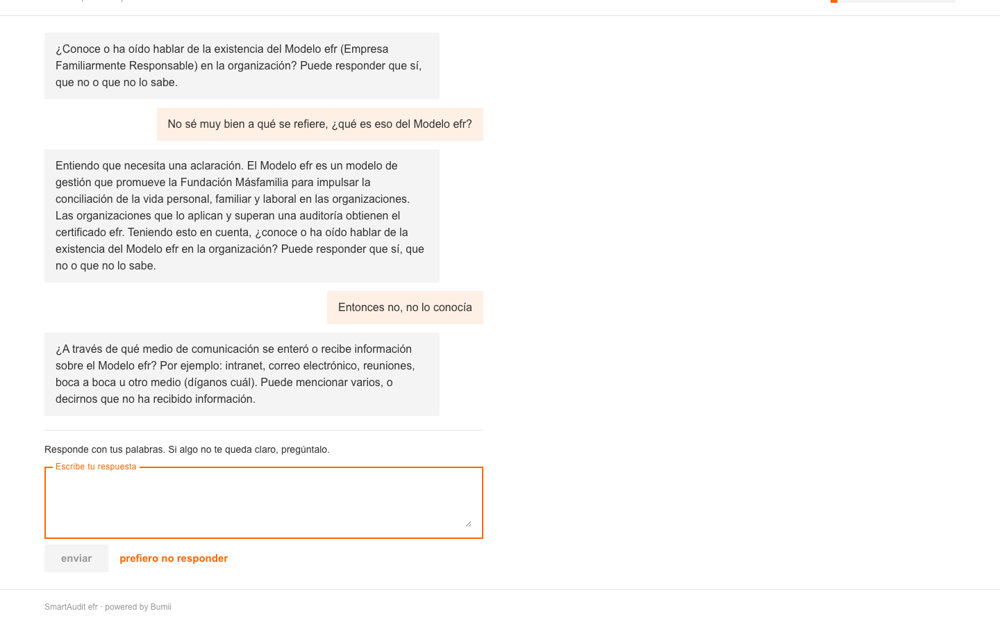

La misma entrevista desde un ordenador: otra persona pregunta «¿qué es eso del Modelo efr?», recibe la explicación,
responde «Entonces no, no lo conocía» y la entrevista sigue con P2.

### 19 · El cuestionario versión 3, para la Fundación

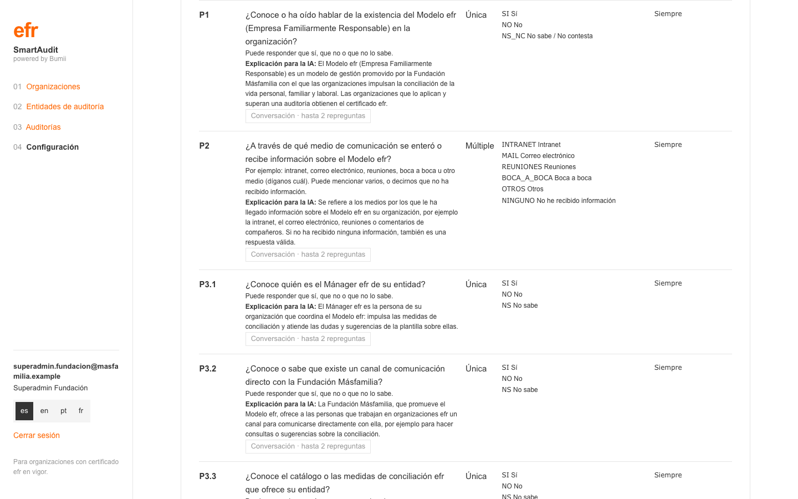

En la configuración del cuestionario, cada pregunta cerrada muestra:

- la **frase que propone las respuestas**;
- la **«Explicación para la IA»**: lo único que la IA puede contar si la persona pregunta;
- la etiqueta **«Conversación · hasta 2 repreguntas»**.

En P2 aparece la nueva opción **«No he recibido información»** (`NINGUNO`). En el ejemplo de la Fundación, «no me han
informado» quedaba como abstención; ahora es una respuesta válida.

---

## Qué necesitamos de la Fundación

1. **Aprobar los textos nuevos**, redactados por Bumii en español, inglés, portugués y francés:
   - las frases que proponen las respuestas;
   - las explicaciones de cada pregunta;
   - la opción de P2 «No he recibido información».
2. **Confirmar la interpretación** de «la IA debe preguntar proponiendo una posible respuesta»: proponemos **todas** las
   respuestas en la pregunta y **una sola** solo para confirmar lo que la persona ha dicho, para no inducir respuestas.
3. **Confirmar «De acuerdo»** como tercera opción de P11–P13. La tabla recibida mostraba solo dos opciones.

## Notas para quien presente

- Las auditorías que ya estaban en curso conservan el cuestionario con el que se abrieron. Las nuevas usan la versión 3
  (entrevista conversada).
- Las respuestas de la IA pueden variar en la redacción de una entrevista a otra. Lo que no varía son las reglas:
  - qué pregunta se hace;
  - cuántas veces se repregunta, y por qué;
  - qué información puede dar;
  - cómo se codifica la respuesta.
- Detalle técnico: decisiones 85–93 en [`docs/decisiones.md`](../decisiones.md).
