# SmartAudit efr · cambios 4 (Fase 3): resultados y revisión

**Fecha:** 25 de noviembre de 2026
**Para:** Fundación Másfamilia (F+f) y equipo Bumii
**Versión en el servidor de pruebas:** https://efr-staging.bumii.ai (cuestionario M1 versión 4)
**Capturas:** [`img/cambios4/`](img/cambios4/) · informes anteriores: [cambios #3](informe-cambios-3.md), [Fase 2](fase-2.md), [Fase 1](README.md)

La Fase 3 convierte las entrevistas en los resultados del informe de auditoría. La llamamos **«cambios 4»** y la
construimos en cinco bloques. Este informe presenta los dos primeros:

- **Bloque 1 · Cálculo de resultados:** las tablas de las secciones 7.1 y 7.2 del informe, calculadas por la
  plataforma.
- **Bloque 2 · Revisión del auditor:** la cola de respuestas dudosas, las respuestas individuales y los comentarios.

Los bloques siguientes son: 3, exportación a Excel; 4, comentarios anonimizados y síntesis con IA; 5, Word, PDF e
informe generado.

Las capturas se hicieron en el **servidor de pruebas con la IA real (Google Gemini)** y **datos sintéticos**: una
auditoría de renovación con excelencia y Bienestar, con 8 personas en la muestra y 7 entrevistas completadas, escritas
con sus propias palabras. Dos de esas personas dejaron a propósito una respuesta poco clara para mostrar la revisión.

---

## En una página

| Qué hace la plataforma | Por qué importa | Capturas |
|---|---|---|
| Calcula las tablas del informe **en código, nunca con la IA**, solo con las entrevistas completadas | Los porcentajes son exactos y reproducibles; la IA no puede alterarlos | 02–08 |
| Calcula los porcentajes **sobre las respuestas válidas** y muestra siempre n, abstenciones y pendientes | Es la regla del informe ed6 y deja ver la base de cada cifra | 04–07 |
| Aplica las reglas especiales: P2 por personas, P7.1 solo si aplica y P8 sin «No sabe» en la base | Son las reglas acordadas para el informe | 04, 05, 06 |
| Reúne en una **cola de revisión** lo que la IA no pudo codificar, con la conversación completa | El auditor decide con todo el contexto y no adivina | 09–11 |
| Recalcula los resultados al momento cuando el auditor decide | La revisión pasa directamente a las tablas | 07 → 12 |
| Muestra las **respuestas individuales** solo tras un aviso de confidencialidad y sin identificar a nadie | Privacidad: el auditor ve demográficos, nunca identidades | 13, 14 |
| Muestra los **comentarios abiertos** aparte y sin datos demográficos | P14 y P15 son «texto libre disociado» | 15 |
| El **coordinador no ve** resultados ni respuestas | Mismo reparto de permisos que hasta ahora | 16, 17 |

---

## Bloque 1 · Cálculo de resultados

### 01 · Nueva sección en la ficha de la auditoría

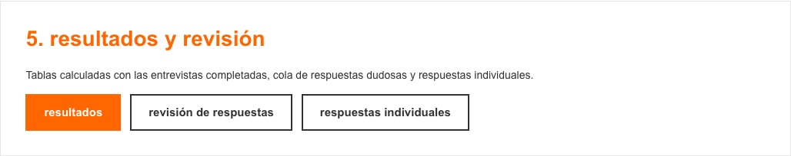

En cuanto la auditoría está en curso, su ficha tiene una sección **«Resultados y revisión»** con tres accesos:
resultados, revisión de respuestas y respuestas individuales. Solo la ven el auditor responsable y la Fundación.

### 02 · Resultados: resumen

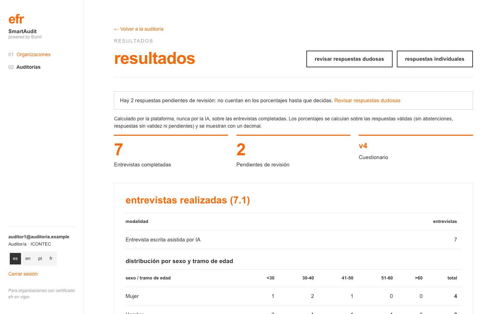

Arriba, un aviso: **hay 2 respuestas pendientes de revisión y no cuentan en los porcentajes hasta que el auditor
decida**. Debajo, el total de entrevistas completadas (7), las pendientes (2) y la versión del cuestionario con la que
se hizo la auditoría.

Mensaje clave: *los resultados los calcula la plataforma, nunca la IA, solo con entrevistas completadas*. Las
entrevistas a medias no cuentan.

### 03 · Sección 7.1: entrevistas realizadas

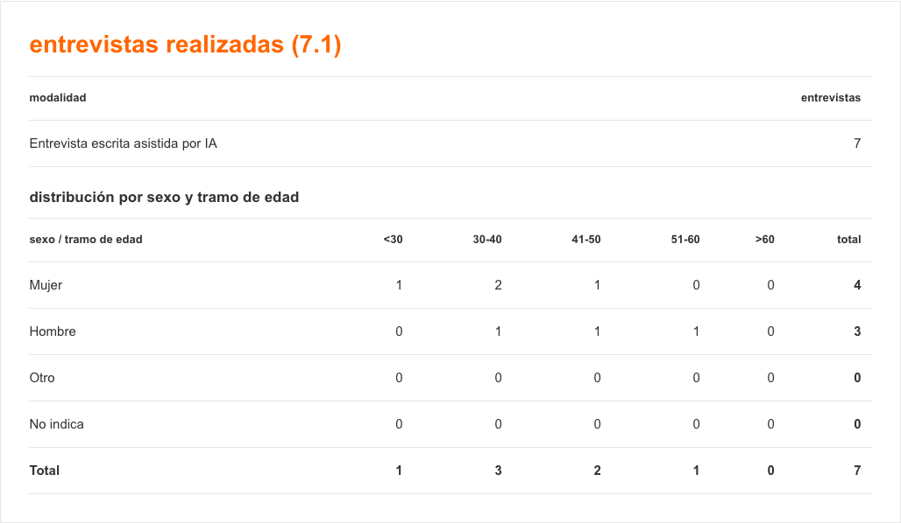

El número de entrevistas por modalidad (la nueva modalidad **«Entrevista escrita asistida por IA»**) y su distribución
por **sexo y tramo de edad**, con los totales de fila y de columna, como pide la sección 7.1 del informe.

### 04 · P2, respuesta múltiple

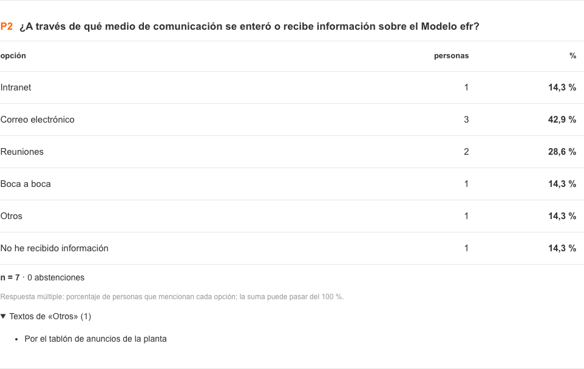

En P2 cada persona puede mencionar varios medios. El porcentaje es **de personas que mencionan cada medio**, así que la
suma pasa del 100 %. La plataforma lo explica debajo de la tabla. Los textos de **«Otros»** se listan, aquí «Por el
tablón de anuncios de la planta». También aparece la nueva opción «No he recibido información».

### 05 · P7.1, pregunta condicionada

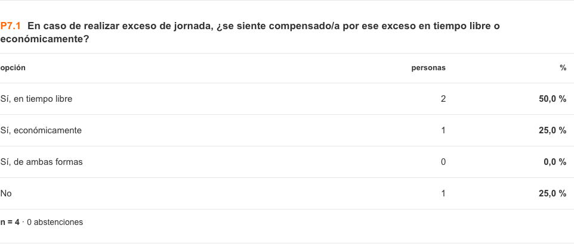

P7.1 («¿se siente compensado/a por el exceso de jornada?») solo cuenta a quienes excedieron la jornada en P7: aquí,
**n = 4** de 7. Si el auditor recodifica la P7 de alguien como «Nunca», su P7.1 sale de la base automáticamente.

### 06 · P8, «No sabe / No contesta» fuera de la base

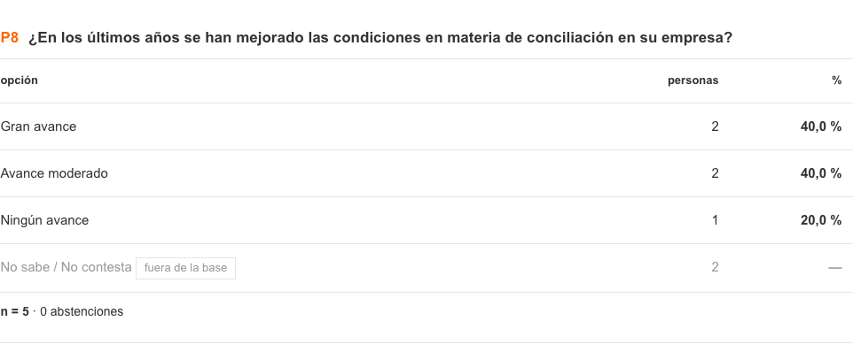

En P8 («¿se han mejorado las condiciones en los últimos años?»), las 2 personas que no lo saben **se cuentan, pero
quedan fuera de la base**. Los porcentajes se calculan sobre las 5 que opinan. Esta regla es configuración del
cuestionario, no código fijo, y la Fundación podría aplicarla a otras preguntas.

### 07 · Una pregunta con una respuesta pendiente

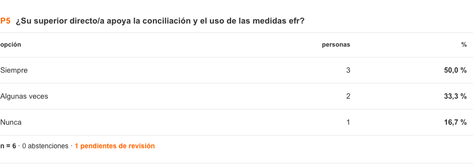

En P5, una persona respondió «depende» tres veces, a pesar de las dos repreguntas de la IA. Esa respuesta queda
**pendiente de revisión** y fuera del cálculo: **n = 6**, con el aviso en naranja.

### 08 · La página completa

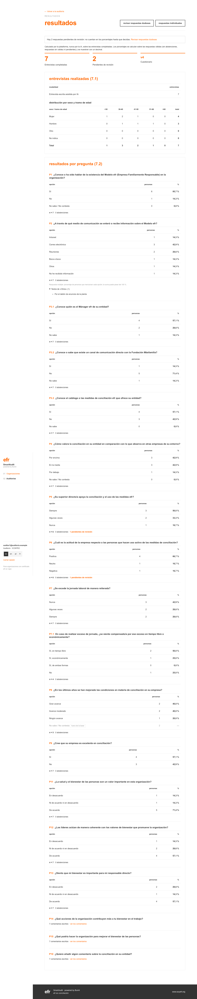

Todas las preguntas, en el orden del cuestionario, con su tabla y su base. Las preguntas abiertas (P10, P14 y P15)
indican cuántos comentarios hay y enlazan a la vista de comentarios.

---

## Bloque 2 · Revisión del auditor

### 09 · La cola de revisión

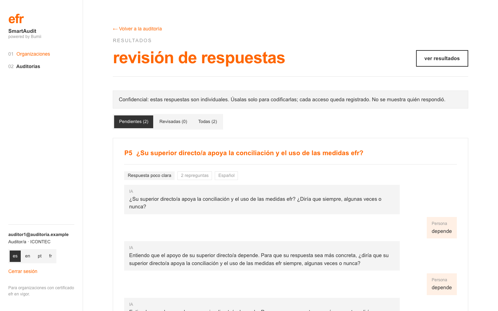

Aquí llegan las respuestas que la IA no pudo codificar con seguridad tras sus repreguntas. Para cada una, el auditor
ve:

- **la conversación completa sobre esa pregunta**: lo que preguntó la IA, lo que respondió la persona y cada
  repregunta;
- el **motivo** de la última repregunta («respuesta poco clara», «fuera de tema», «preguntó qué significaba»…), el
  número de repreguntas y el idioma de la entrevista;
- **lo que propuso la IA** y con qué confianza.

No se muestra quién respondió, y un aviso recuerda que la información es confidencial y que cada acceso se registra.

### 10 · La decisión del auditor

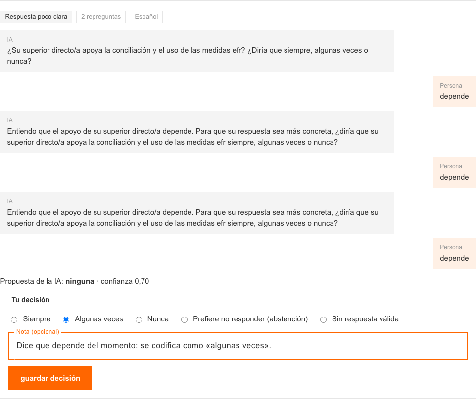

El auditor elige **la opción** que corresponde, la **abstención** o **«sin respuesta válida»**, y puede dejar una
nota. En el ejemplo, la persona dice que depende del momento y el auditor lo codifica como «Algunas veces». La otra
respuesta pendiente hablaba del comedor en lugar de la actitud de la empresa, y el auditor la marcó como «sin
respuesta válida».

### 11 · Respuestas revisadas

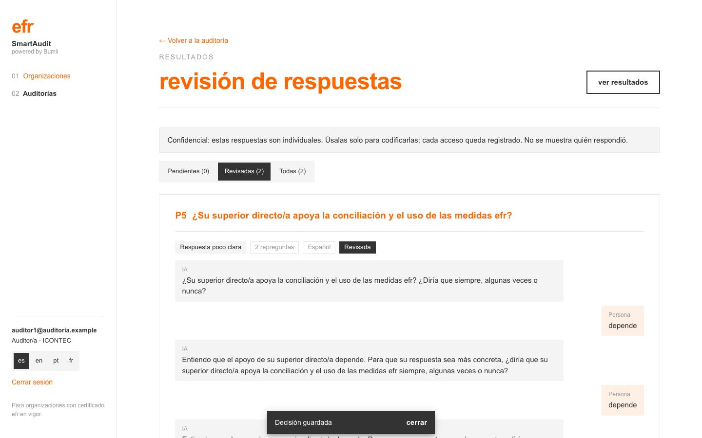

El filtro **Pendientes / Revisadas / Todas** permite volver a las decisiones tomadas y cambiarlas mientras no se haya
generado el informe. Cada decisión queda registrada: quién, cuándo y qué decidió.

### 12 · Los resultados se actualizan al momento

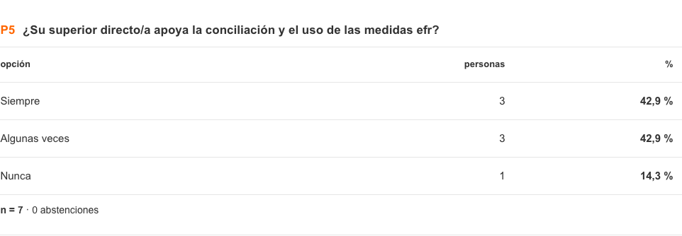

P5 pasa a **n = 7**, sin pendientes. «Algunas veces» sube de 2 a 3 personas y los porcentajes se recalculan solos.

### 13 · Aviso de confidencialidad

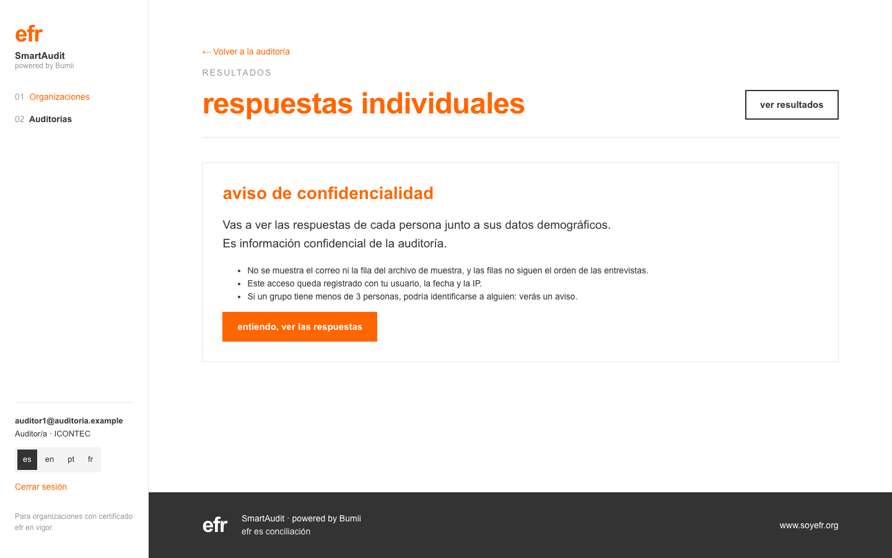

Las respuestas individuales **no se cargan** hasta que el auditor acepta el aviso:

- no se muestra el correo ni la fila del archivo de muestra;
- las filas no siguen el orden de las entrevistas;
- el acceso queda registrado;
- se avisará si un grupo es tan pequeño que podría identificar a alguien.

### 14 · Respuestas individuales

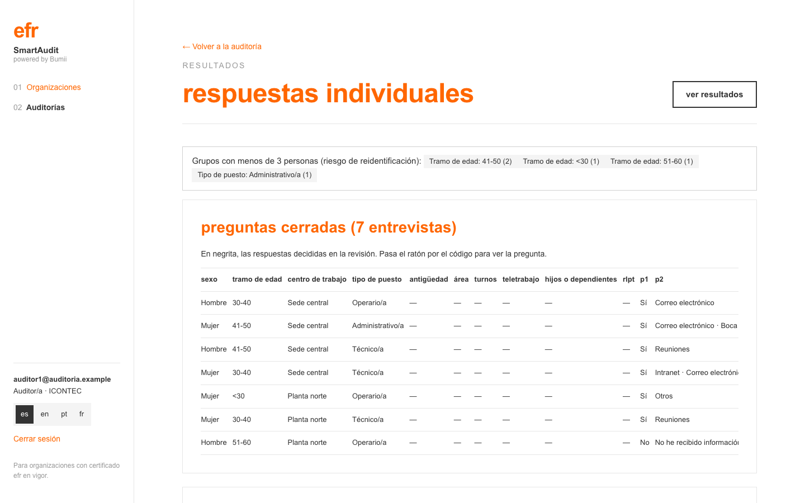

Una fila por entrevista completada, con sus datos demográficos y la respuesta codificada de cada pregunta cerrada. Las
respuestas decididas en la revisión aparecen en negrita.

Arriba, el aviso de **grupos con menos de 3 personas** (por ejemplo, un único «Administrativo/a» o una sola persona
de menos de 30 años): son los casos en que cruzar datos podría identificar a alguien.

### 15 · Respuestas abiertas, disociadas

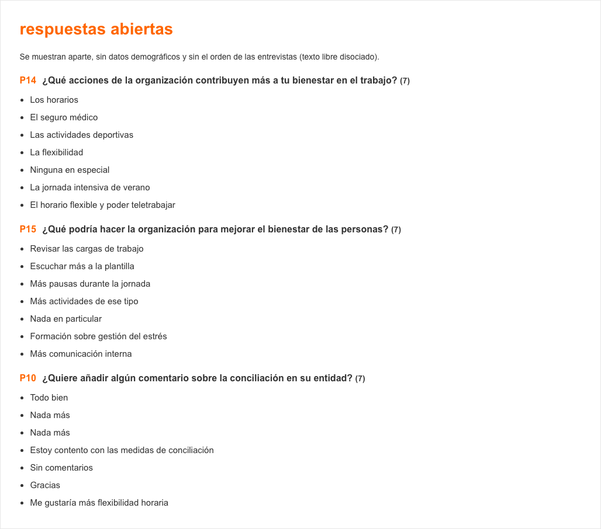

Las respuestas a P14, P15 y P10 se muestran **aparte, sin datos demográficos y sin el orden de las entrevistas**. Para
P14 y P15 lo pide la tabla de Bienestar («texto libre disociado»). P10 recibe el mismo trato hasta que exista la
anonimización de comentarios (bloque 4), porque un comentario puede contener datos que identifiquen.

---

## Permisos

### 16 · El coordinador ve la ficha, no los resultados

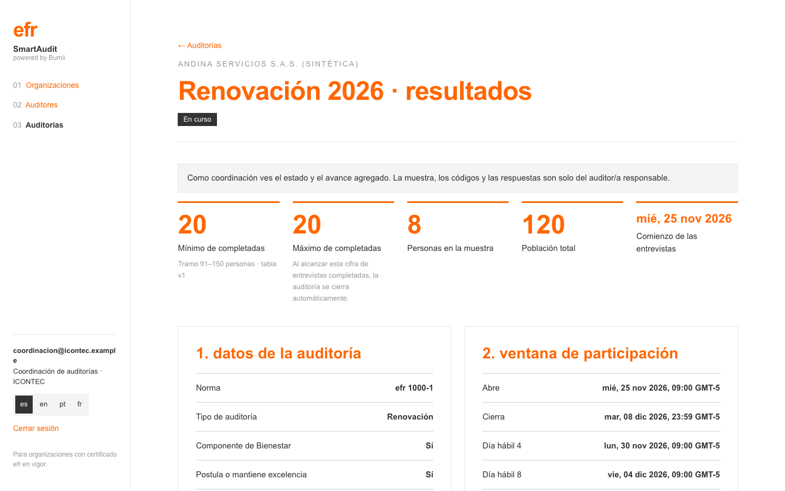

El coordinador de la entidad de auditoría sigue viendo el estado y el avance agregado, pero no la sección de
resultados.

### 17 · Ni siquiera entrando por la dirección

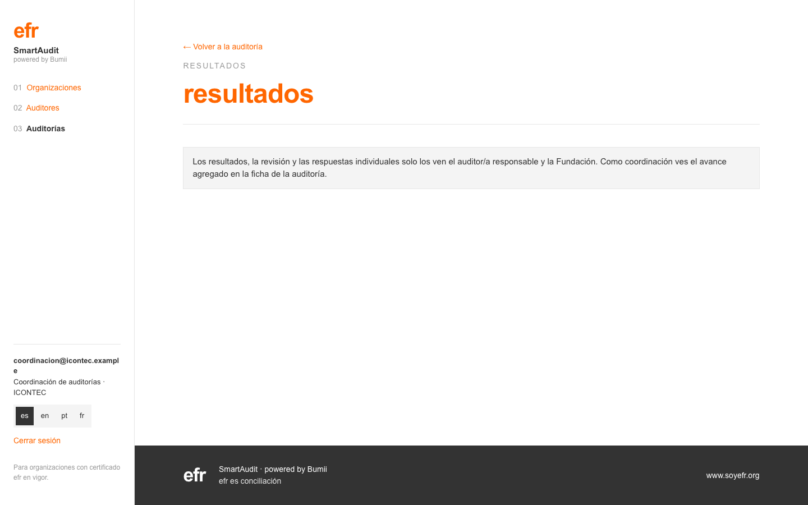

Si intenta abrir los resultados directamente, la plataforma lo deniega y le explica quién puede verlos. Lo mismo
ocurre con la revisión y las respuestas individuales.

---

## Qué necesitamos de la Fundación

1. **La plantilla ed6 en Word**, secciones 7.1 a 7.3, para el bloque 5.
2. **Los Excel reales** de una auditoría inicial y de una de renovación, anonimizados, para comprobar los cálculos cifra
   a cifra.
3. **Confirmar el redondeo:** proponemos un decimal, sin forzar que los porcentajes sumen 100 (siempre se muestra n).
4. **Confirmar las reglas especiales:**
   - ¿«No sabe / No contesta» sale de la base solo en P8, o también en P1 y P4?
   - ¿P10 debe ir siempre disociada de los demográficos?

## Notas para quien presente

- Las cifras de las capturas son de un ejemplo sintético de 7 entrevistas; no son resultados reales.
- Todos los cálculos están cubiertos por pruebas automáticas, incluido un caso de referencia calculado a mano.
- Detalle técnico: decisiones 94–97 en [`docs/decisiones.md`](../decisiones.md).
